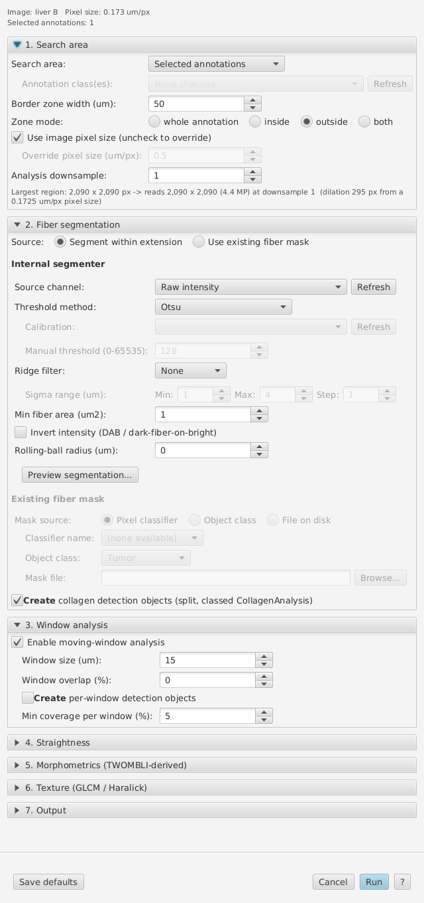
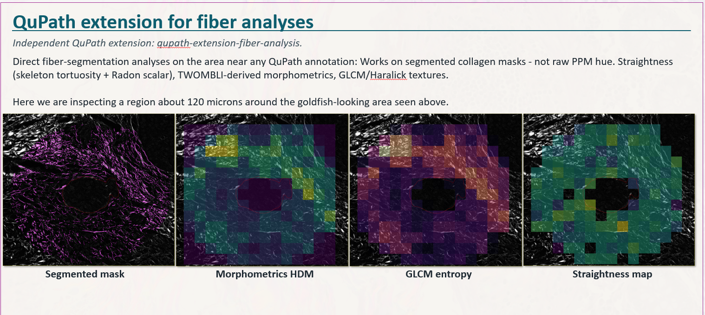

# qupath-extension-fiber-analysis

Collagen fiber analysis testbed for QuPath -- straightness,
morphometrics, and texture metrics over a dilated border around an
annotation.

> **Status: testbed / experimental.** This extension is a research
> prototype for evaluating fiber-analysis methods against the
> dilated-border search-area pattern. **Research use only. Not for
> clinical decision-making.** It is **not** in a QuPath extension
> catalog; install the JAR by hand (below). Interfaces, parameter names,
> and output formats may change between revisions. Use the production
> `qupath-extension-ppm` for shipped PPM analysis; use this repository
> to evaluate metrics that may or may not later graduate.

## Install

1. Download `qupath-extension-fiber-analysis-<version>-all.jar` from
   the repository's
   [Releases page](https://github.com/uw-loci/qupath-extension-fiber-analysis/releases).
2. Drag the jar onto the QuPath window, or copy it into QuPath's user
   extensions folder (on Linux `~/QuPath/v0.7/extensions/`).
3. Restart QuPath. The extension appears under
   `Extensions > Fiber Analysis`.
4. Build the Python environment once (Quick start, step 1). It is
   cached, by default in `~/.local/share/appose/qupath-fiber-analysis/`;
   the setup window shows the folder it uses.
5. Linux and Windows are the supported targets. macOS is not
   verified.

The extension needs QuPath 0.7.

**Migration:** not applicable -- new extension. No prior preferences,
project metadata, or UI surfaces are being replaced.

## Quick start

1. **On first run only:** `Extensions > Fiber Analysis > Setup
   environment...`, then click **Build environment**. This downloads
   and builds the Python (Appose / Pixi) environment: several minutes,
   network required. The status line shows each step; when it reads
   "Setup complete. fiberlib <version>" the **Build environment**
   button grays out and you can close the window (opened again later,
   it reads "Status: environment appears built"). If you skip this
   step, the first analysis builds the environment itself before it
   starts, which takes the same several minutes.
2. Open an image in QuPath (RGB or single-channel).
3. Draw an annotation around the region of interest -- typically a
   tumor-stroma boundary.
4. `Extensions > Fiber Analysis > Run analysis... (research use only)`
5. In the dialog, set the border zone width + zone mode (search area);
   pick the segmentation source (**Segment within extension** =
   threshold / ridge filter; **Use existing fiber mask** = a pixel
   classifier, the objects of one class, or a mask file); pick which families
   to run (straightness, morphometrics, texture); click **Run**.
6. The Python module runs via Appose and writes per-annotation
   overlays + a `windows.json` sidecar. Results appear in the **Fiber
   Analysis Results** panel, and, with **Create collagen detection
   objects** ticked (the default), one `CollagenAnalysis` detection per
   fiber blob is added under your annotation. The annotation itself
   gets no measurements -- tick **Create per-window detection objects**
   (Section 3) if you want per-window metrics in the measurement
   table.

To run the same settings over many images, see
[Project batch runs and calibration](#project-batch-runs-and-calibration).



## What the analyses tell you

<details>
<summary><strong>What each analysis family measures</strong></summary>

The three metric families run over a dilated border zone around the
annotation. The example below inspects a region about 120 microns wide
and shows, left to right, the segmented fiber mask, a morphometrics
HDM map, a GLCM entropy map, and a straightness map.



**Straightness / persistence.** Distinguishes wavy from straightened
collagen fibers. In TACS-3 breast pathology (Conklin et al. 2011,
*Am J Pathol* 178:1221), straightened fibers perpendicular to the
tumor-stroma boundary act as contact-guidance tracks for invading
cells (HR 3.0-3.9 for disease-specific and disease-free survival, independent of grade,
size, receptor status). The wavy-to-straight axis recurs in arterial
adventitia, sclera, alveolar wall, and cardiac fibrosis. We report
per-window skeleton tortuosity (chord / arc, CT-FIRE convention --
Bredfeldt et al. 2014, *J Biomed Opt* 19(1):016007) plus per-annotation
Radon-transform alignment scalars (peak-to-mean ratio, FWHM at theta*;
Radon-based fiber alignment after Schaub et al. 2011, *Proc SPIE*). A
tiled run (very large annotations) skips Radon.

**Morphometrics.** Shape statistics of the segmented fiber graph,
native re-implementation of the cheap metrics from TWOMBLI (Wershof
et al. 2021, *Life Sci Alliance* 4(3):e202000880) -- HDM coverage,
total fiber length, branch / end-point counts, fractal dimension via
box-counting, lacunarity, and max-inscribed-circle gap analysis.
TWOMBLI's FIJI plugins are not bundled; the extension stays
Apache-2.0. See Caveats for implementation-difference notes.

**Texture.** Spatial heterogeneity of fiber density and packing --
the information fiber-tracing misses (a dense uniform mat and a
sparse clumped field can share mean alignment but differ in
texture). Per-window GLCM / Haralick features (contrast,
correlation, energy, homogeneity, entropy, dissimilarity) via
scikit-image. Framing follows the 3-D texture review (Depeursinge et
al. 2014, *Med Image Anal* 18(1):176-196) and the radiomics feature
set (Aerts et al. 2014, *Nat Commun* 5:4006). True-3D / volumetric
texture is out of scope -- our data are 2-D; only the feature math
transfers.

</details>

## Parameters

<details>
<summary><strong>The parameter table</strong></summary>

Every control in the Run dialog (`Run analysis... (research use
only)`), in dialog order, with its default. The defaults are the
values a fresh install shows; **Run** and **Save defaults** both store
the current values, and the dialog opens with them next time. The user
guide ([`documentation/fiber-analysis.md`](documentation/fiber-analysis.md))
explains each family in depth; this table is the at-a-glance
reference. Sections 4-6 start collapsed.

| Label | Section | Default | Units | What it does |
|---|---|---|---|---|
| Search area | 1. Search area | Selected annotations | -- | Which annotations to analyze: `Selected annotations`, `All annotations in image`, or `Annotations of class...` (the classes checked below). |
| Annotation class(es) | 1. Search area | (none checked) | -- | Classes to analyze when Search area is `Annotations of class...`. Lists the full class name including derived-class colons ("Tumor: Stroma"); "Unclassified" matches annotations with no class. **Refresh** re-reads the classes. |
| Border zone width (um) | 1. Search area | 50.0 | um | Width of the band at the annotation boundary that is analyzed. Ignored with `whole annotation`. |
| Zone mode | 1. Search area | outside | -- | `inside` / `outside` / `both`: a band of the border-zone width at the boundary. `whole annotation`: the entire interior. |
| Use image pixel size (uncheck to override) | 1. Search area | checked | -- | Read the pixel size from the image. |
| Override pixel size (um/px) | 1. Search area | 0.5 | um/px | Pixel size used when the box above is unticked. |
| Analysis downsample | 1. Search area | 1.0 | -- | Read the region at 1/N resolution. Pixels read fall by N squared. Lengths and areas are converted with the effective pixel size (image pixel size x N), but fibers thinner than a downsampled pixel are lost, and every setting that is rounded to whole pixels (window size, GLCM distances, box sizes) is rounded at the coarser size, so results at different downsamples do not compare. |
| Source | 2. Fiber segmentation | Segment within extension | -- | `Segment within extension` (threshold, optional ridge filter) or `Use existing fiber mask`. |
| Source channel | 2. Fiber segmentation | Raw intensity | -- | Scalar channel the internal segmenter thresholds: `Raw intensity`, `Hue (HSV)`, `Saturation (HSV)`, `Value (HSV)`, or one of the image's own channels by name. On an RGB image Raw intensity is the same as Value (the brightest of R, G, B). On a multi-channel image that is not RGB, Raw intensity and Value use the brightest channel at each pixel, and Hue and Saturation are not offered. 16-bit sources keep their full precision. **Refresh** re-reads the channels. |
| Threshold method | 2. Fiber segmentation | Otsu | -- | `Otsu`, `Triangle`, `Manual`, or `Project Otsu (calibrated)`. Otsu and Triangle are fitted once per run over all its annotations. |
| Calibration | 2. Fiber segmentation | last used, else the first found | -- | Which saved project calibration `Project Otsu (calibrated)` applies; enabled only for that method. Make one with **Calibrate threshold...** in `Run on project images...`. A red note appears when the calibration was fitted with other settings. |
| Manual threshold (0-N) | 2. Fiber segmentation | 128 | gray level | Cutoff in the source image's own gray levels; on a single-channel 16-bit image the spinner runs 0-65535. Enabled only for Manual. With a ridge filter selected it becomes **Response cutoff (0-1)** (default 0.1), a cut on the filter's response, where 1 is a fiber at full contrast; a dim image can respond far below 0.1, and **Preview segmentation** shows the strongest response in view. |
| Ridge filter | 2. Fiber segmentation | None | -- | Optional line filter before the threshold: `None`, `Frangi`, `Sato`, `Meijering`. |
| Sigma range (um): Min / Max / Step | 2. Fiber segmentation | 1.0 / 4.0 / 1.0 | um | Fiber half-widths the ridge filter looks for. |
| Min fiber area (um2) | 2. Fiber segmentation | 1.0 | um2 | Connected components smaller than this are removed. |
| Invert intensity (DAB / dark-fiber-on-bright) | 2. Fiber segmentation | unchecked | -- | Flip bright and dark before thresholding. Tick it when fibers are darker than the background (DAB, trichrome blue). |
| Rolling-ball radius (um) | 2. Fiber segmentation | 0.0 | um | Background subtraction (morphological top-hat) before thresholding; 0 turns it off. |
| Preview segmentation... | 2. Fiber segmentation | -- | -- | Button: segments a small square around the viewer center with the current settings and shows the mask. |
| Mask source | 2. Fiber segmentation | Pixel classifier | -- | With `Use existing fiber mask`: `Pixel classifier`, `Object class` or `File on disk`. |
| Classifier name | 2. Fiber segmentation | first in the project | -- | Pixel classifier whose fiber channel is used. |
| Object class | 2. Fiber segmentation | first in the project | -- | Class whose objects are rasterized to a binary mask. |
| Mask file | 2. Fiber segmentation | (empty) | -- | A `.tif` or `.npy` binary mask (**Browse...**). |
| Create collagen detection objects (split, classed CollagenAnalysis) | 2. Fiber segmentation | **checked** | -- | Adds one `CollagenAnalysis` detection per connected fiber blob under the source annotation. On by default, so a run changes the image's hierarchy. |
| Enable moving-window analysis | 3. Window analysis | checked | -- | Divide the analyzed zone into a grid of windows and report per-window metrics. |
| Window size (um) | 3. Window analysis | 15.0 | um | Side length of each square window, rounded to whole pixels. |
| Window overlap (%) | 3. Window analysis | 0 | percent | Overlap between adjacent windows (0-90). |
| Create per-window detection objects | 3. Window analysis | unchecked | -- | One rectangular detection per window above the coverage gate, carrying that window's metrics. Can be thousands per annotation. |
| Min coverage per window (%) | 3. Window analysis | **5.0** | percent | Windows whose fiber coverage is below this are dropped: no metrics, transparent in every heatmap, no detection. On by default; set 0 to keep every window. |
| Enable straightness analysis | 4. Straightness | checked | -- | Master toggle for tortuosity and Radon. |
| Per-window skeleton tortuosity | 4. Straightness | checked | -- | Chord/arc ratio along traced fibers (CT-FIRE convention; 1 = straight). |
| Per-ROI Radon scalar (peak/mean, FWHM) | 4. Straightness | checked | -- | One set of Radon alignment scalars per annotation. Skipped on a tiled run. |
| Min branch length (um) | 4. Straightness | 5.0 | um | Skeleton branches shorter than this are pruned as noise. |
| Enable morphometrics | 5. Morphometrics (TWOMBLI-derived) | checked | -- | Master toggle for the TWOMBLI-derived metrics. |
| Branch-point count | 5. Morphometrics | checked | -- | Skeleton junctions (Rutovitz crossing number >= 3). |
| Endpoint count | 5. Morphometrics | checked | -- | Skeleton end points (one neighbor). |
| Total fiber length | 5. Morphometrics | checked | -- | Skeleton length in um. |
| Mean curvature | 5. Morphometrics | checked | -- | Mean tangent turning along traced fibers, in rad/um. |
| HDM coverage | 5. Morphometrics | checked | -- | Fiber area in the zone / zone area. |
| Lacunarity | 5. Morphometrics | checked | -- | Gappiness at each box size (gliding box). |
| Fractal dimension | 5. Morphometrics | checked | -- | Box-counting dimension of the skeleton. |
| Gap analysis | 5. Morphometrics | checked | -- | Widths of the gaps between fibers: the diameter of the largest empty circle at each gap center inside the zone. |
| Lacunarity box sizes (um) | 5. Morphometrics | 0.5,1,2,4,8 | um | Box sizes for lacunarity, converted to whole pixels. |
| Fractal box sizes (um) | 5. Morphometrics | 0.25,0.5,1,2,4,8,16 | um | Box sizes for the fractal dimension, converted to whole pixels. |
| Enable GLCM texture | 6. Texture (GLCM / Haralick) | checked | -- | Master toggle for per-window GLCM / Haralick features. |
| Quantization levels | 6. Texture | 16 | gray levels | Number of gray levels the gray range is split into before the GLCM (8-256). |
| GLCM distance(s) (um) | 6. Texture | 0.1,0.2,0.3 | um | Offsets at which co-occurrence is counted. Each is rounded to whole pixels at the effective pixel size (at least 1 px) and duplicates are merged, so the default gives 1 and 2 px at 0.1732 um/px but only 1 px at 0.25 um/px or coarser; the log warns when distances merge. |
| Gray range | 6. Texture | Set by hand | -- | `Set by hand`, or fitted once per run on sampled fiber pixels: `1st to 99th percentile of fibers`, `Mean +/- 3 SD of fibers`, `Minimum to maximum of fibers`. A fitted range disables the two spinners below and differs between runs. |
| Gray range minimum | 6. Texture | 0 | gray level | Bottom of the gray range, in the source's own units. |
| Gray range maximum | 6. Texture | 0 | gray level | Top of the gray range; 0 means the image's full scale. A dim image on full scale lands in one or two levels and its texture reads as flat, so set the range to fit the fibers and use the same range for every image you compare. A run reports the fibers' own range and warns when too few levels were used. |
| Properties: contrast, correlation, energy, homogeneity, entropy, dissimilarity | 6. Texture | all checked | -- | Which GLCM features to compute. |
| Also one value per distance | 6. Texture | unchecked | -- | With two or more distances, also report each feature at each distance, e.g. `Contrast (GLCM, 10.05 um)`, next to the average over all distances. |
| Output directory | 7. Output | (blank) | -- | Base folder for the run. Blank means `<project>/fiber-analysis/` with a project open, otherwise `~/QuPath/fiber-out/`. Each run writes a timestamped subfolder. |
| Write fiber-mask overlay PNG | 7. Output | checked | -- | Save the segmented mask as a magenta overlay PNG. Written anyway when collagen detection objects are on, because they are built from it. |
| Write straightness heatmap PNG | 7. Output | checked | -- | Save a heatmap of per-window tortuosity (chord/arc). |
| Write GLCM heatmap PNG + Property | 7. Output | checked, contrast | -- | Save per-window texture heatmaps. **Currently every enabled GLCM property gets its own PNG**; the **Property** choice is recorded in `params.json` but does not limit what is written. |
| Write morphometric summary text | 7. Output | checked | -- | Write `morphometrics_summary.txt` with the annotation-level morphometrics. |
| Write results.json sidecar | 7. Output | checked | -- | Write the annotation-level result dictionary as `results.json`. |
| Write per-window arrays (.npz) | 7. Output | unchecked | -- | Write `window_metrics.npz` (per-window NumPy arrays). |
| Add per-window detection objects to hierarchy | 7. Output | mirrors Section 3 | -- | Read-only mirror of **Create per-window detection objects**. |

The footer has **Save defaults**, **Cancel**, **Run** and **?** (opens
the user guide, also F1; see the note at the top of the guide).

</details>

## Outputs

<details>
<summary><strong>Files written by a run</strong></summary>

Each run writes a folder `<base>/YYYYMMDD_HHMMSS_<hash>/` under the
output directory, holding `params.json`, `params.txt`, `rerun.groovy`
and `threshold.json` (see the next section), `run_notes.txt` when the
run has something to report (a batch's pixel-size choice, a texture
warning), and one subfolder per annotation, `annotation_NNN_<name>/`.
Filenames are ASCII.

Per-annotation files (the PNGs only when their Output box is ticked):

- `windows.json` -- the window grid: one record per grid cell (schema
  below).
- `fiber_mask_overlay.png` -- the segmented fiber mask, magenta where
  fiber, transparent elsewhere.
- `straightness_overlay.png` -- viridis heatmap of per-window
  tortuosity (chord/arc).
- `texture_<prop>_overlay.png` -- magma heatmap, one per enabled GLCM
  property.
- `morphometrics_overlay.png` -- per-window HDM heatmap, plus one
  `morph_<metric>_overlay.png` per per-window morphometric (coverage,
  HDM, ridge count, length, branch points, endpoints, curvature,
  fractal dimension, lacunarity, gap widths). These are written with the
  fiber-mask overlay.
- `morphometrics_summary.txt` -- annotation-level morphometrics as text.
- `results.json` -- the annotation-level result dictionary.
- `window_metrics.npz` -- per-window NumPy arrays (off by default).
- `boundary_mask.png`, `zone_mask.png` -- the rasterized annotation and
  analysis zone the run used. (`region.png`, the image read, is deleted
  once the annotation has been analyzed, unless it failed.)

A **tiled** run (an annotation over 64 megapixels at the read scale)
writes the merged `windows.json` and, with the sidecar on, a summary
`results.json` at the annotation level, and keeps every tile's own
files under `tiles/tile_NNNNN/`. It writes no annotation-level PNGs.
See the user guide, "Large annotations are tiled automatically".

**`windows.json` schema.** A wrapper object, not a bare list:

```
{
  "meta": {...},            # versions, run id and the full parameter echo
                            #   (a tiled run's merged file: tiled, n_tiles,
                            #   pixel_size_um, window_size_um, window_overlap_percent)
  "window_px": int,         # window side in pixels (at the read scale)
  "stride_px": int,         # distance between window origins
  "window_um": float,
  "grid_shape": [rows, cols],   # untiled runs only
  "windows": [
    {
      "x": int, "y": int,       # window top-left, read-scale pixels from the region origin
      "w": int, "h": int,       # window size in pixels
      "included": bool,         # false = below "Min coverage per window"
      "n_fiber_px": int,        # fiber pixels in the window
      "fiber_coverage_percent": float,   # n_fiber_px / window area * 100
      # the rest only when included is true:
      "n_fibers": int,          # traced fibers in the window ("Ridge count")
      "hdm": float,             # fiber in zone / zone pixels in this window
      "mean_angle_deg": float,  # axial mean fiber orientation, 0-180 (0 = horizontal)
      "order_parameter": float, # 0 = isotropic, 1 = perfectly aligned
      "tortuosity_median": float,         # median chord/arc (1 = straight)
      "texture": {"contrast": float, ...},           # one key per enabled property
      "texture_by_distance": {"<d_px>": {...}, ...}, # with "Also one value per distance"
      "total_length_px", "total_length_um", "branch_points", "endpoints",
      "mean_curvature_per_px", "mean_curvature_per_um", "fractal_dimension",
      "lacunarity_box_<b>", "lacunarity_mean",
      "gap_mean_px", "gap_max_px", "gap_mean_um", "gap_max_um": float
    },
    ...
  ]
}
```

Every grid cell has a record. A cell below the coverage gate is a stub
with `included: false` and only the first seven keys. Metrics that
could not be computed are `null` (mean angle and order parameter need
at least 10% of the window to be fiber). In a tiled run's merged file,
`null` keys are left out instead. To place a window on the image:
full-image x = `x` * analysis downsample + the region's left edge
(`region.offset_x` in an untiled `results.json`, in full-image pixels).

Load it in pandas with:

```python
import json
import pandas as pd

with open("windows.json") as f:
    doc = json.load(f)
df = pd.json_normalize(doc["windows"])  # one row per window; columns texture.contrast, ...
df = df[df["included"]]                 # drop the below-coverage stubs
```

(`pd.json_normalize(doc)` on the whole file gives one row, not one per
window.)

Optional **per-window detections** are added only when "Create
per-window detection objects" is on in Section 3, one per included
window. A 50 x 50 grid is 2500 objects.

</details>

## Reproducing a run from disk

<details>
<summary><strong>Re-running from params.json</strong></summary>

Every file-producing analysis drops three companion artifacts next to its
outputs:

- `params.json` -- pretty-printed JSON with a top-level `meta` block
  (`versions`, `run: {timestamp_utc, run_id, ...}`) and the full
  insertion-ordered `parameters` block. This is the machine-readable record
  of what was actually run.
- `params.txt` -- the same key/value list as a `key = value`-per-line text
  file. Grep-friendly; quick to scan.
- `rerun.groovy` -- a self-contained Groovy script that re-executes the
  analysis headlessly via QuPath's script mode. All paths are baked in as
  string literals; edit the script if the project moves.

To re-run from disk (no GUI clicks):

```
~/path/to/QuPath script <output-dir>/rerun.groovy
```

Per analysis, the files land as follows:

| Analysis | Output dir | Files |
|---|---|---|
| Per-annotation fiber analysis | `<base>/YYYYMMDD_HHMMSS_<hash>/` | `params.json`, `params.txt`, `rerun.groovy`, and `threshold.json` (the cut every annotation in the run used, how it was obtained, and the settings it applies to) |
| Project density map | `<project>/fiber-analysis/density-maps/` | `<image>_density_params.json`, `<image>_density_params.txt`, `<image>_density_rerun.groovy` (one set per image) |
| Project calibration | `<project>/fiber-analysis/` | `calibration_<name>_params.txt`, `calibration_<name>_rerun.groovy` (the existing `calibration_<name>.json` is itself the params record the rerun reads) |

The rerun scripts use the project + image names recorded in the params at
write time. If you move the project to a different machine or path, open
the `.groovy` file and adjust the `projectPath` (and `imageName(s)`) at the
top of the file.

</details>

## Project batch runs and calibration

<details>
<summary><strong>Running one set of settings over many images</strong></summary>

`Extensions > Fiber Analysis > Run on project images...` (needs an open
project) opens **Fiber Analysis -- Batch (research use only)**. From top
to bottom:

1. A yellow box, **Calibrate threshold across this project
   (recommended)**, with the **Calibrate threshold...** button (below).
2. **Params:** click **Browse...** and pick the `params.json` of an
   earlier run (it is in that run's `YYYYMMDD_HHMMSS_<hash>/` folder).
   The batch uses those settings, including the Search area and class
   filter. To make one, set up the Run dialog on one image and run it.
3. If those settings use an automatic **Gray range**, a red box warns:
   the range is fitted to these images' own pixels, so texture may be
   inconsistent between images and with any other run; do not use it
   when the intensity distribution is expected to differ, for example
   on a negative control. The same text goes into each image's
   `run_notes.txt`.
4. **Filter project images**: **Name:** keeps images whose name
   contains the text (case-insensitive); **Class override:** replaces
   the loaded class filter for this batch (comma-separated,
   case-sensitive, e.g. `Tumor, Stroma`).
5. The image list, with **Select all** / **Select none**.
6. **Run on selected images**.

Images run one after another, and each gets its own run folder. Each
image is saved after its run, so its collagen (and, if ticked,
per-window) detections stay in the project; an image open in the viewer
gets them in the view as well. Before
the first image the batch checks pixel sizes (see the guide, "Images of
different pixel sizes"); with Otsu or Triangle it fits one threshold
over every selected image's analysis zones, and with an automatic gray
range one range, so the batch is comparable within itself. Images with
no matching annotation are skipped. At the end a notification gives
`ran`, `skipped` and `failed` counts, and a second one appears if
results in the project were cut at different thresholds.

**Calibrate threshold...** opens **Fiber Analysis -- Calibrate project
threshold**. It fits one Otsu threshold on a random sample of project
annotations and saves it under a name, so separate runs and density
maps can share it through **Project Otsu (calibrated)**. Its settings:

| Label | Default | What it does |
|---|---|---|
| Calibration name | default | Name shown in the Run dialog's **Calibration** list. |
| Sample size | 50 | Annotations sampled at random (1-5000). |
| Use all available annotations | unchecked | Use every matching annotation instead of a sample. |
| Image name filter | (blank = all images) | Only images whose name contains this text (case-insensitive). |
| Class filter | (blank = all classes) | Comma-separated classes; `Unclassified` matches annotations with no class. |
| Source channel | the Run dialog's | `Raw intensity`, `Hue (HSV)`, `Saturation (HSV)` or `Value (HSV)`. |
| Ridge filter | the Run dialog's | Must match the run's, or the run refuses the calibration. |
| Invert intensity (DAB / dark-fiber-on-bright) | the Run dialog's | Tick for stains where fibers are darker than background. |
| Rolling-ball radius (um) | the Run dialog's | Background subtraction before the fit. |
| Border zone width (um) | the Run dialog's | Zone width the samples are taken from. |

Zone mode, analysis downsample and the ridge-filter sigmas come from
the Run dialog's saved settings. **Run calibration** writes
`<project>/fiber-analysis/calibration_<name>.json` (the threshold as
`threshold_normalised`, a fraction of the channel's full scale, with
the filters, seed, regions used and histogram counts), plus
`calibration_<name>_params.txt` and `calibration_<name>_rerun.groovy`.
A run with **Project Otsu (calibrated)** refuses a calibration fitted
with a different source channel, ridge filter, sigmas, invert or
rolling-ball setting, and the Run dialog says so in red.

</details>

## Project density map (WSI scale)

<details>
<summary><strong>The whole-slide density-map workflow</strong></summary>

A separate workflow for **whole-slide density-map output**: tile-streams
each selected image, runs the same per-window analysis the regular
"Run analysis..." dialog does, and writes a small map file per image
(one float32 value per channel per window step) at
`<project>/fiber-analysis/density-maps/<image>_density.ome.tif`.
Show it as an overlay, sample it into object measurements, or add it as
channels in a new project entry; the original image is never changed.

Menu: `Extensions > Fiber Analysis > Project density map...`

### Output (you pick at dialog time)

- **Map file only** (default). Use `Show density map as overlay...`
  and `Sample fiber density into measurements`.
- **Also add each image with its density channels as a new entry**.
  After the run, each image gets a new project entry
  `<image> [fiber density]`: the image converted to 32-bit float,
  followed by the map's channels at the image's size, for QuPath's
  `Add intensity features`, thresholders or classifiers. RGB images
  are shown red / green / blue over 0-255 so they look like the
  original. The entry is tagged `Fiber analysis`, `Fiber source image`
  and `Fiber map` in the project metadata for sorting. It reads the map
  file when opened, so keep the file and the extension installed.

### Validation rules in the dialog

The dialog opens a split-pane picker. Left = project images with
pixel type / dimensions / calibration status (populated in a
background thread). Right = settings. A live validation banner
gates the Run button:

- Any selected image **without pixel calibration** -- **blocked**
  in either mode (the um window size can't be translated).
- Otherwise ready; the banner says whether each image will also get a
  channels entry.

### Map file format

- One float32 value per channel per window step (not per image
  pixel), planar, 256x256 tiles, LZW; halving pyramid levels (each the
  NaN-aware mean of the level below) only when the grid is larger than
  256 px.
- Values are physical; NaN means no data. Channel names match the
  QuPath measurement-table column names.
- The image description places the grid on the source image with a
  `Placement:` line (`source_width`, `source_height`,
  `source_pixel_um`, `cell_px`, `window_px`, `x0`, `y0`, `grid`,
  `render`) and names the source image. Grid pixel (i, j) covers source
  pixels `x0 + i*cell_px` to `x0 + (i+1)*cell_px`; `render` is
  `bilinear` (interpolate between cell centers) or `nearest`.
- A channel row ending `; axial=180` (`Mean angle (deg)`) is an
  axial angle: interpolated, pyramid-averaged and sampled as an angle.
  The overlay shows it with the cyclic map `Angle (cyclic)` over
  0-180 (copied from TME Quant, same names).
- The OME physical pixel size is `cell_px * source_pixel_um`.
- Files written before 2026-10-19 were full image resolution (9 GB
  for a 0.3-gigapixel slide with Smooth on) and are refused; re-run.

### Menu items at a glance

| Item | What it does |
|---|---|
| `Project density map...` | Open the picker, pick images, Run. Writes one map file per image; with the channels option, also adds each image with its density channels as a new project entry and opens the current image's. |
| `Sample fiber density into measurements` | For the open image, reads its map and writes the mean of each channel inside each target object (read every quarter cell; a smaller object takes its center's value) as `Density: <channel>`. Targets selected objects when any are selected, otherwise all annotations. |
| `Show density map as overlay...` | Draw one channel of a density or classifier map over the open image in color, on QuPath's pixel-classification layer: the image's own maps, or a map from another project image of the same size (another image of the same slide). Exact at any zoom; the location bar shows the value under the cursor. The image is not changed. |
| `Add density channels as a new image` | Add a new project entry: the open image (as float32) followed by its density map's channels, tagged `Fiber analysis` / `Fiber source image` / `Fiber map` in the project metadata. The original entry is not changed; adding again refreshes the same entry. |

### Limitations

- **Skeleton counts at tile seams.** Each tile is read with a margin of
  surrounding image, so coverage, orientation and the threshold-free
  channels match a whole-image computation; skeleton-based counts
  (ridge count, branch points, skeleton length) can still differ
  slightly at tile seams, because a fiber can run any distance.
- **Sequential per-tile Appose calls** -- a 100k slide is roughly
  10-15 min. NDArray IPC + tile batching is a known speed
  follow-up.
- **The eight fiber channels are always written**: `Fiber coverage
  (%)`, `Ridge count`, `Skeleton length (um)`, `Branch points`, `Mean
  angle (deg)`, `Order parameter`, `Signal density (no threshold)`,
  `Intensity coherence (no threshold)`. The dialog adds optional
  **object-density** channels (one per chosen class) and
  **pixel-positivity** channels (one per channel and cut); there is no
  per-channel toggle for the eight.

</details>

## Troubleshooting

<details>
<summary><strong>Common problems and what to do about them</strong></summary>

### The **Fiber mask** overlay -- what the magenta should look like

The fiber-mask overlay paints **magenta (255, 0, 255) at alpha ~200** wherever
the segmenter judged a pixel to be fiber, within the analysis zone (the
**Fiber mask** toggle on the results-panel card shows it). If you see no overlay at
all, see the table below; if you see magenta in a "wrong" place, that's
almost always one of three things:

| Symptom | Likely cause | Fix |
|---|---|---|
| **The whole analysis zone painted magenta** | Threshold is too low (Otsu picked a value that's saturating everything), or you have DAB / dark-fiber staining and didn't tick `Invert intensity`. The mask reads "everything is fiber" because the wrong polarity made background look brighter than fiber. | Open Section 2; for DAB / trichrome / any chromogenic where fibers are darker than background, tick `Invert intensity`. Otherwise try `Manual` threshold and step up. |
| **No magenta visible at all** | Three possibilities: (a) the segmenter found zero fiber pixels (threshold too high, or wrong source channel), (b) you switched images since the overlay was painted -- the old overlay is auto-cleared when the image changes, (c) QuPath's overlay opacity slider (toolbar) is at 0. | Check (c) first. For (a), click **Summary** on the result card -- if `fiber_in_zone_pixels = 0`, segmentation failed; change source channel or lower threshold. |
| **Magenta outside the annotation polygon** | Expected with Zone mode `outside` or `both`: the zone is a band beyond the boundary, and the overlay shows fiber in the zone only. | None. With `inside` or `whole annotation`, magenta outside the polygon is not expected; see the next row. |
| **Magenta is shifted / offset from the actual fibers** | Coordinate-transform bug, should be filed -- the workflow records the region origin as `region.offset_x` / `offset_y` in `results.json`. | Save the results folder + a screenshot and open an issue. |
| **Magenta on a totally different image** | The image was switched while the overlay was active and the listener didn't catch it (rare). | Click `Hide overlay` on the results-panel header, or close the result window (auto-clears). |

### The **Morph:** or **GLCM:** list on a result card is short or missing

Each result card has the toggles **Fiber mask** and **Straightness**,
the lists **Morph:** and **GLCM:**, and **Summary**. The lists hold the
heatmap PNGs that exist for that annotation: **GLCM:** one entry per
enabled texture property, **Morph:** up to 15 per-window morphometrics
(`fiber_coverage_percent`, `hdm`, `ridge_count`, `total_length_px`,
`total_length_um`, `branch_points`, `endpoints`,
`mean_curvature_per_px`, `mean_curvature_per_um`,
`fractal_dimension`, `lacunarity_mean`, `gap_mean_px`, `gap_mean_um`,
`gap_max_px`, `gap_max_um`; per-box lacunarity is in `windows.json`
only). An entry is missing when its metric or family was off, or when
its PNG was not written: the **Morph:** heatmaps are written only with
the fiber-mask overlay, and a tiled run writes no annotation-level
PNGs at all (look under `tiles/`).

### Project-calibrated Otsu picked an absurd threshold

If the calibration's `threshold_normalised` is near 0 or near 1, the pool
probably wasn't representative of the workflow's real targets. Common
causes:

- **Mixed staining types in the calibration pool.** Use the calibration
  dialog's `Image name filter` and `Class filter` to restrict the pool to
  one staining type / one tissue class.
- **DAB or trichrome was in the pool without `Invert intensity` ticked.**
  Calibrate again with invert on -- the calibration pool will then mean
  the same thing as the run-time threshold path.
- **Sample size too small.** Default is 50; for projects with high
  variability across sections, raise to 100+ or tick `Use all available
  annotations`.

The full calibration provenance (filter, seed, regions used, histogram
counts) is in `<project>/fiber-analysis/calibration_<name>.json` for
post-hoc inspection.

### Settings aren't sticking across QuPath restarts

**Run** saves the dialog state, as **Save defaults** does. If a parameter still
reverts after restart, two things to check:
- Did `Save defaults` get clicked while the dialog was open? Save defaults
  also writes -- they don't compete, but a partial earlier save can mask
  the issue.
- Are you running the same JAR as the one in
  `~/QuPath/v0.7/extensions/`? Outdated extensions land there
  occasionally; verify the JAR's mod time matches the latest build.

### `ModuleNotFoundError: No module named 'appose'` on Setup environment

The bundled `pixi.toml` is missing the `appose` conda dep. Fixed on
2026-05-26. Re-run `Extensions > Fiber Analysis > Setup environment...`
-- the env will auto-rebuild because `ApposeFiberService.syncManifest()`
compares the on-disk `pixi.toml` AND `pixi.lock` against the JAR-bundled
copies and wipes `.pixi/` when either differs.

### "thread death" appears in the Python console

Known Appose race -- a stale worker emits `FAILURE("thread death")` on its
next task *before any Python runs*, and Appose then relaunches that task
inside the same worker as an untracked zombie.

`ApposeFiberService.runTask` recovers from this automatically: it restarts
the Python worker (which kills the zombie, so two copies of the analysis
can never race on one output directory) and retries the task once on the
fresh worker. It only does so when no `LAUNCH`/`UPDATE` event arrived for
the task -- a "thread death" *after* Python started is a real mid-run
death and is reported, not retried, because re-running would repeat
whatever the script had already written. The recovered case logs at WARN;
everything else logs at ERROR. If you see it land repeatedly on the same
task, file an issue with the console log.

### Density-map: the map file opens but shows no data

The map is float32 and NaN means no data, so an empty map is NaN (drawn
transparent), not 0. Common causes: no window held any fiber under the
current segmentation settings (`Fiber coverage (%)` is NaN where a
window has no fiber; check the settings with **Preview
segmentation...** in the Run dialog first), or **Analyze:** was limited
to annotations and none matched. The dialog blocks images with no pixel
size; set one in QuPath before computing.

### Density-map: measurements from attached channels look wrong

Before 2026-10-19, `Attach density channels` stored the map in the
image's own pixel type, so on an 8-bit or 16-bit image every map value
was cut to a whole number (a signal density of 0.12 read 0). Re-run the
density map, then use `Add density channels as a new image` (32-bit
float) or `Sample fiber density into measurements`.

### Density-map: "This map file has no placement line"

The map was written before maps were stored at grid resolution.
Re-run `Project density map...` (or the window classifier) for that
image.

### Density-map: "Sample fiber density into measurements" doesn't add any columns

Three checks:
1. Did the density compute finish for that image? Look for
   `<project>/fiber-analysis/density-maps/<image>_density.ome.tif`.
2. Are there target objects? The command samples selected objects
   first; if nothing is selected, it falls back to every annotation.
   If neither set exists, it bails out with an error.
3. Does the object overlap map cells that hold data? No-data cells
   are NaN and are skipped; an object over no data at all gets NaN for
   every channel.

</details>

## Caveats

- Radon is computed once per annotation, over the largest disk
  inscribed in the region, not per window. Per-window straightness at
  15 um is workable when fibers span the window, and degrades below
  that.
- Native morphometrics will not match TWOMBLI numerically to 3
  decimals -- the FIJI plugins are not bundled and the macro is
  unlicensed, so the implementation is independent. Expect parameter
  sensitivity for fractal dimension and lacunarity in particular.
- GLCM distances are rounded to whole pixels and duplicates merged, so
  at coarse pixel sizes the default `0.1,0.2,0.3` um is a single 1 px
  offset (see the parameter table). Nothing caps the distance against
  the window size; keep it well below the window side.
- Steger ridge detection is **out of v1 scope** -- fiber-width
  distributions are therefore not provided. Ridge filters
  (Frangi/Sato/Meijering) supply a mask, not a width-annotated
  centerline.
- Segmentation quality bounds metric quality. A thresholded mask with
  broken fibers gives an inflated branch-point count and a depressed
  straightness; check the segmentation overlay before interpreting
  metrics.
- Linux + Windows are tested; macOS is not verified. Multichannel
  (HSV-cube) Haralick, true-3D / volumetric texture, and a TACS-3
  classifier are also out of v1.

## Cite-as / License

Apache-2.0 (see [`LICENSE`](LICENSE)). If you use this in published
work, cite Wershof 2021 (TWOMBLI method), Bredfeldt 2014 (CT-FIRE
straightness convention), and Aerts 2014 (radiomics texture features)
as appropriate. The full list is section 11, References, of the user
guide ([`documentation/fiber-analysis.md`](documentation/fiber-analysis.md)).

### Why no FIJI plugins?

We deliberately do **not** bundle TWOMBLI's FIJI plugin dependencies
(Ridge Detection, AnaMorf, OrientationJ, BIOP Max Inscribed Circles).
All four are GPL; bundling would relicense this extension from
Apache-2.0 to GPL-3.0. The TWOMBLI macro itself ships without a
LICENSE file and is therefore not redistributable. We cite Wershof
et al. 2021 for the method and re-implement the cheap morphometric
metrics natively in Python (scikit-image + numpy).

Practical consequence for users comparing numbers: native fractal
dimension and lacunarity will diverge from TWOMBLI by roughly
**20-40%**, not the "few percent" you might expect from "same
algorithm, different implementation." TWOMBLI's upstream is
**Steger ridge-extracted centerlines** (width-annotated curvilinear
structures), whereas this extension's upstream is a **thresholded /
vesselness-filtered binary mask** skeletonized with
`skimage.morphology.skeletonize`. Different skeletons feed different
box-counts and lacunarity boxes. We explicitly do **not** provide
Steger ridge detection; see user guide section 7.
