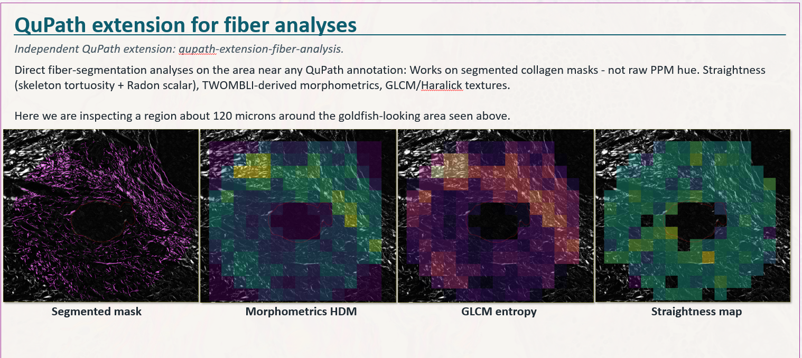
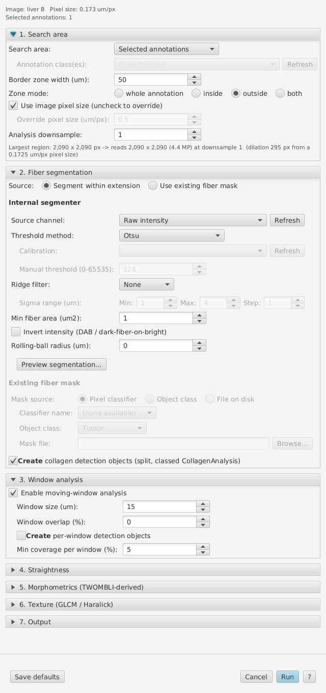

# Fiber Analysis -- User Guide

[Back to README](../README.md)

---

This guide expands on the README's "What the analyses tell you"
section. Each numbered section is collapsible -- click the summary
line to expand. The math notes (sections 5-8) are the source of truth
for what the Python module computes; the README parameter table is
the source of truth for the dialog.

The **?** button (or F1) in the Run dialog opens this file with your
system's default program for `.md` files. That is often a plain text
editor, which shows the `<details>` and `<summary>` tags as text with
every section expanded; the sections collapse when the file is viewed
on GitHub or in a Markdown viewer.

Framing note (per the Phase 0 Lead correction): this extension
analyzes **segmented collagen fibers**, not raw birefringence hue.
Orientation, where it appears at all, is the geometric tangent of the
fiber skeleton. There is no hue-to-angle calibration.

---

<details>
<summary><strong>1. Overview</strong></summary>

This extension is a research **testbed** for quantifying collagen
fiber organization around a user-drawn annotation. It takes a
segmented fiber mask (either produced internally from intensity
thresholding plus optional ridge filtering, or supplied by the user
from a pixel classifier / object class / file) over a **dilated
border zone** around the annotation, and reports three families of
metrics: **straightness / persistence**, **morphometrics** (the
cheap, segmentation-only subset of TWOMBLI), and **GLCM / Haralick
texture**. The headline use case is the wavy-to-straight axis of
collagen organization -- the same axis underlying TACS-3 in breast
pathology (Conklin et al. 2011) and, more broadly, fiber
reorganization in tumor invasion, arterial adventitia, sclera,
alveolar wall, and cardiac fibrosis. Collagen density promotes mammary
tumor initiation and progression (Provenzano et al. 2008), and
oriented collagen fibers direct tumor cell intravasation (Han et al.
2016). The PS-TACS workflow shipped by
the production `qupath-extension-ppm` is a related but distinct
analysis (Qian et al. 2025): PS-TACS scores **perpendicularity** of
fibers relative to the boundary using a hue-calibrated orientation
field, whereas this extension scores **shape and texture of the
segmented fibers themselves**, with no hue calibration.

The four outputs from one analyzed region -- here a border zone about
120 microns wide -- are the segmented fiber mask, a morphometrics HDM
map, a GLCM entropy map, and a straightness map:



Read the document in order if you are setting up the workflow for
the first time. Section 2 explains how an annotation becomes
per-window metrics; sections 3 and 4 cover the two inputs the user
controls most (search-area dilation and segmentation source); section
5 explains the moving-window grid that the rest of the pipeline
builds on; sections 6-8 are the metric families; section 9 lists
output files; section 10 catches common failures; section 11
collects citations.

</details>

<details>
<summary><strong>2. Workflow</strong></summary>

The pipeline is a linear chain:

```
QuPath annotation
        |
        v
dilated-border zone (mask)        <-- Section 3
        |
        v
fiber segmentation                <-- Section 4
  (internal: threshold + optional ridge filter)
  (existing: pixel classifier / object class / file)
        |
        v
moving-window grid over the zone  <-- Section 5
        |
        v
+-----------------+-----------------+-----------------+
|                 |                 |                 |
v                 v                 v                 v
per-window      per-window       per-ROI         per-window
tortuosity      morphometrics    Radon scalar    GLCM features
(Section 6)     (Section 7)      (Section 6)     (Section 8)
        |
        v
overlays (PNG) + windows.json + optional PathObjects
```

The Run dialog drives this chain. Section 1 sets the search area
(border zone width and zone mode), Section 2 picks the segmentation
source, and Section 3 configures the moving-window grid; the
Straightness, Morphometrics, Texture, and Output sections follow
below:



The Java side reads the annotation geometry, rasterizes the dilated
border zone, and dispatches an Appose task with the parameter dict.
The Python module (`fiberlib/`) is bundled inside the JAR; it loads
from JAR resources at run time so the analysis code is always in
sync with the JAR you installed. The Appose env (Pixi-managed) lives
at `~/.local/share/appose/qupath-fiber-analysis/` and is built on
first use.

## Reproducing a run from disk

Every analysis that writes files (per-annotation Run, Project density map,
Project calibration) also drops three companion artifacts next to its
outputs:

- `params.json` -- pretty-printed JSON: extension version, timestamp,
  run id, and every dialog control.
- `params.txt` -- same key/value pairs as plain `key = value` lines; easy
  to skim or grep.
- `rerun.groovy` -- a Groovy script that re-executes the same analysis
  headlessly. Project path, image name, and `params.json` path are baked
  into the top of the file as string literals; edit them if the project
  moves.

To re-run from disk with no GUI:

```
~/path/to/QuPath script <output-dir>/rerun.groovy
```

The Groovy templates use the existing extension entry points (the same
`runForAnnotations` / `runForEntries` / `FiberCalibrationRunner.run` the
GUI dialogs call). A per-annotation re-run writes a new timestamped run
folder next to the original (under `<project>/fiber-analysis/`, or the
Output directory recorded in `params.json`); it does not replace the
original run's files. A re-run fits its own threshold and, with an
automatic gray range, its own range, from the same settings.

## Which threshold a result was cut at

Fiber coverage, skeleton length and every other fiber measurement depend on
the threshold the mask was cut at and on the pixel size the image was analyzed
at, so two results are comparable only when both match. Every result records
them in one line:

```
Otsu 0.08337 | Otsu pooled over 2 annotation(s) on 1 image(s): 21 sample(s) of their analysis zones (7595099 px), run 20261021_121322_9afbe194 | settings d176f3aa at 0.1725 um/px
```

The first part is the cut: the method and value (a fraction of the channel's
full scale, `gray level N` for a Manual cut, or `response N` with a ridge
filter). The second says how it was obtained: pooled in which run or batch,
`calibration '<name>'`, or `set by hand`. The third is a fingerprint of the
settings that decide what the cut means (source channel, ridge filter and its
sigmas, invert, rolling ball, minimum fiber area) and the pixel size the image
was analyzed at: its own pixel size times the analysis downsample. Two results
are comparable when the cut and fingerprint match and the pixel sizes are
within 2%, however the cut was obtained.

The line is written to:

- `threshold.json` in an annotation run's folder, with the settings spelled
  out;
- the image's project entry metadata, as `Fiber threshold (annotations)` for
  the latest annotation run and `Fiber threshold (density map)` for its density
  map, so the project list and the metadata browser can sort and filter by it;
- each detection a run creates, as object metadata `fiber_analysis.threshold`,
  and each object a density map is sampled into, as
  `fiber_analysis.map_threshold`;
- a density or classifier map's file description (a `Threshold:` line) and
  `_density_params.json` (`thresholdIdentity`).

After a run, the extension compares the lines recorded on every image of the
project. When they fall into more than one group it shows a short notification
naming each group's cut, pixel size and images, and marking the run that just
finished. The log has the full text, which also says how each cut was obtained:

```
Results in this project were cut at 2 different thresholds or pixel sizes, so they are not all comparable:
  Otsu 0.08337 at 0.1725 um/px, settings d176f3aa (Otsu pooled over 2 annotation(s) ..., run 20261021_121322_9afbe194) [this run]: liver_L002
  Otsu 0.09620 at 0.345 um/px, settings d176f3aa (pooled over 1 annotation(s) on 1 image(s), run 20261020_090000_1a2b3c4d): coarse copy
To compare them, run them together (a batch can analyze images of different pixel sizes at one common size), or use one project calibration.
```

A batch run makes this comparison once, at its end. To make a whole project
comparable, run it as one batch, or calibrate once and use **Project Otsu
(calibrated)** everywhere.

## Images of different pixel sizes

Fine fibers merge at a coarse pixel size, so coverage, skeleton length, branch
counts and gap widths shift with resolution even when every setting is in
microns. Texture shifts further: its GLCM distances become whole-pixel offsets,
and the default 0.1, 0.2 and 0.3 um become 1 and 2 px at 0.17 um/px but only 1
px at 0.35 um/px. So every run over several images checks their pixel sizes
first (sizes within 2% count as the same):

- **Batch runs** ask what to do when the images differ:
  - **Analyze all at X um/px** brings every image to the coarsest one, using a
    larger analysis downsample on the finer images. Their results then compare,
    and each run folder's `run_notes.txt` records the common size and the
    downsample used on that image.
  - **Each at its own size** keeps the finer images' detail, but their numbers
    do not compare with the coarser ones. If texture is on and its pixel
    offsets would differ between the images, texture is left out of the whole
    batch, and `run_notes.txt` says why.
  - **Cancel** runs nothing.
- **Project calibration** asks the same question and records the choice in
  the calibration file (`common_pixel_um`, or `mixed_pixel_sizes`).
- **Project density map** reads every image at full resolution, so it cannot
  bring them to one size. Its dialog shows each image's pixel size, the banner
  warns when they differ, and Run asks for confirmation.
- **The window classifier** will not train on images of different pixel sizes,
  or on an image with no pixel size: its features are measured in pixels, and
  Apply already refuses an image more than 2% off the training pixel size.

Images with no pixel size use the **pixel-size override** in a batch run, and
the question names them; set their pixel size (Image > Set pixel size) to
include them properly.

## Project density map (whole-slide)

For density-of-fiber maps across an entire slide, use the separate
**Project density map** workflow rather than the per-annotation Run
dialog. It tile-streams each selected image, runs the same per-window
computations, and writes one small map file per image at
`<project>/fiber-analysis/density-maps/<image>_density.ome.tif`.
`<image>` is the image name with `\ / : * ? " < > |` and spaces turned into
`_`, which is what QuIET's `{imageSafe}` token gives. A name over 200
characters is cut and ends in `_` and an 8-character hash, so two long names
never share a file. (Until 2026-10-26 names were cut at 60 characters, so
`slide.ome.tif (1)` and `slide.ome.tif` could get the same file.)

**A tile that cannot be read or written stops that image.** No map is written
for it, the run moves on to the next image, and the finishing message counts it
as failed. The message names the tile and the folder the tile images go to,
usually the system temp folder; a full drive is the usual cause.

**The map file holds one value per window, not per image pixel.** A 25 µm
window moved 6.25 µm at a time on a 16952 x 18225 slide at 0.1732 µm/px is a
467 x 503 grid, a few megabytes. That grid is all the information the map has:
each value averages one window, and drawing it at full image resolution only
repeats or interpolates those values. (Until 2026-10-19 the file was written at
full image resolution, 9 GB for that slide with **Smooth** on. Maps from before
then cannot be read; re-run them.)

The file is a float32 OME-TIFF, so values are physical (`Fiber coverage (%)`
reads 0-100, `Order parameter` 0-1); NaN means no data. Its description says
where the grid sits on the image:

```
Placement: source_width=16952; source_height=18225; source_pixel_um=0.1732; cell_px=36; window_px=144; x0=54; y0=54; grid=467x503; render=bilinear
Source image: <the image the map was computed on>
Threshold: <the threshold the map was cut at; see "Which threshold a result was cut at">
Region: <where the map was computed; see "Computing only inside annotations">
```

Grid pixel (i, j) covers image pixels `x0 + i*cell_px` to `x0 + (i+1)*cell_px`
across (and the same with `y0` down): the block centered on the window that
produced it, so the map sits over the tissue it describes. `render` says how to
draw between cells (below, **Smooth**). The `Mean angle (deg)` channel row ends
in `; axial=180`: it is averaged and interpolated as an angle of period 180. Image pixels outside the grid have no
value: in per-window mode, a strip half a window wide around the windows and,
at the right and bottom, up to one more stride. Channel names match the QuPath
measurement-table column names: `Fiber coverage (%)`, `Ridge count`,
`Skeleton length (um)`, `Branch points`, `Mean angle (deg)`, `Order parameter`,
`Signal density (no threshold)`, `Intensity coherence (no threshold)`.

Three ways to use a map:

- **Show it as an overlay** (next section). The image is not changed.
- **Sample it into measurements**: `Sample fiber density into measurements`
  adds a `Density: <channel>` measurement per channel to each selected object
  (or every annotation): the mean of the map inside the object, read every
  quarter cell (the mean angle as an axial mean). An object smaller than that
  takes the value at its center. Each object also gets the map's threshold as
  metadata (`fiber_analysis.map_threshold`).
- **Add it as channels in a new image**: `Add density channels as a new image`,
  or the first output option in the dialog for every image in the run. This
  adds a new project entry named `<image> [fiber density]`: the image, converted
  to 32-bit float, followed by the map's channels at the image's size, for
  QuPath's `Add intensity features`, thresholders or classifiers. The original
  entry is not changed. The new entry copies the original's metadata (and its
  objects as last saved) and adds three keys, `Fiber analysis` (`Density
  channels` or `Classifier channels`), `Fiber source image` and `Fiber map`, so
  it can be sorted or filtered in the project list and the metadata browser.
  On an RGB image the first three channels are shown red, green and blue over
  0-255, so it looks like the original; the map channels start hidden. Adding
  the same map again refreshes that entry instead of making another, and
  re-running the map refreshes it too. The entry reads the map file when it
  opens, so it needs this extension installed and the map file kept. Channels
  entries are left out of the density-map image list (and skipped if a script
  passes one): they hold maps, not a source image, and their 32-bit float
  pixels are not yet supported as input.

  Before 2026-10-19 this attached the channels to the open image instead, and
  values were stored in the image's own pixel type: on an 8-bit or 16-bit image
  every map value was cut to a whole number (a signal density of 0.12 read 0).
  Measurements taken that way are wrong.

### Computing only inside annotations

Most of a whole slide is often glass. **Analyze:** at the top of the dialog
sets where the map is computed, with the same choices as TME Quant:

| Choice | Computes the windows that touch |
|---|---|
| **Whole image** (default) | every window of the image |
| **Inside selected annotations** | the area annotations selected in the open image. Pick only that image in the list. |
| **Inside every area annotation** | any area annotation of each image, whatever its class |
| **Inside area annotations of class:** | area annotations of the classes chosen below it, for example `Tissue` |

The grid is always laid over the whole image, so a limited map has the same
`Placement:` line as a whole-image map and lines up with the image (and in
QuIET) in exactly the same way. Each value is the same value a whole-image run
gives for that window; the windows that do not touch the annotations are left
empty (NaN, drawn transparent). The time saved comes from the tiles that hold no
such window: they are not read at all.

A few details:

- **A window counts if any of it overlaps an annotation**, so values reach up to
  one window past the annotation's edge. A window that crosses the edge is
  computed over the whole window, glass included, exactly as in a whole-image
  map; it is not clipped to the annotation.
- **Only area annotations count.** Lines and points are ignored.
- **An image with no matching annotation is skipped**, not failed, and no map is
  written for it. The finishing message counts skipped images.
- **The map reads the saved annotations.** If the open image has unsaved
  changes, the dialog asks to save it first.
- **Selected annotations are recorded by ID.** The re-run script finds them again
  by ID, so they must still exist in the saved image.
- **With Otsu or Triangle**, the run-wide threshold is fitted on samples inside
  the region rather than over the whole image, so glass does not pull it
  down. The `Threshold:` line says so ("... inside area annotations of class
  Tissue").
- **Pixel-positivity channels** read only the tiles that touch the region too.
  Object-density channels are computed from the objects as before and emptied
  outside the region like every other channel.

The map file records the choice and what it found, for example:

```
Region: area annotations of class Tissue; 3 annotation(s), 4.212e+07 um^2
```

A whole-image map says `Region: whole image`. The `_params.json` file stores
`regionMode` (`whole`, `selected`, `any` or `classes`), `regionClasses`,
`regionAnnotationIds` and `regionAnnotationNames`, and the re-run script repeats
the region in a comment and replays it. **Show density map as overlay...**
shows the region in its **Region** row. Maps made before this option have no
`Region:` line; they always cover the whole image.

### Showing a map as an overlay

`Extensions > Fiber Analysis > Show density map as overlay...` draws one channel
of a density map (or of a window-classifier probability map) over the open
image in color, without changing the image. Pick the map, the channel, one of
QuPath's color maps and a value range (**Auto** uses the 1st to 99th
percentile). The list holds the open image's own maps first, then maps made on
any other project image of the same size, marked `(from <image>)`: other images
of the same slide, such as a map computed on the birefringence image shown over
the brightfield one. No-data areas are transparent. The overlay is colored from
the grid at screen resolution each time the view changes, so it is exact at any
zoom, and the viewer's location bar shows the map value under the cursor.
**Hide values at or below the minimum** leaves the lowest values undrawn instead
of painting them in the first color, so the image shows through where there is
nothing to see, such as the slide background around the tissue. Set the minimum
to the background level first. The **Threshold** row shows what the map's fibers
were cut at; maps made before 2026-10-21 say it was not recorded.

**Mean angle (deg)** is an orientation, where 1 and 179 degrees are two degrees
apart. A linear color map paints those two at opposite ends of the scale, so
choosing that channel switches to the cyclic map **Angle (cyclic)**, whose last
color is its first, and fixes the range to 0-180 so a color means the same
angle on every image (**Auto** keeps 0-180 for this channel). **Angle (cyclic
vivid)** is the saturated hue wheel: easier to read, but yellow looks brighter
than blue, so use it to show results rather than judge them. Both maps come from
TME Quant and keep its names, so with both extensions installed each appears
once. **Brightness from** darkens the color where a 0-1 channel is low; for the
angle it defaults to **Order parameter**, so well-aligned fibers show strong
color and randomly oriented ones fade to black instead of getting a confident
hue. (Order parameter needs fibers; **Intensity coherence** works without a
threshold.) Where the map is drawn smooth, the angle is interpolated as an
angle, so 170 and 10 degrees blend through 0, not 90; the same holds for
sampling and the channels entry. It
sits on QuPath's pixel-classification layer, so the opacity slider and **Show
pixel classification** (`C`) control it, and showing it replaces a pixel
classifier overlay. An RGB image keeps its normal look.

A window-classifier map's **Predicted class index** channel is drawn in the
color each class already has in QuPath, not on a color map, so the color map,
range and hide controls are switched off for it. The class names come from the
map's `P(<class>)` channels. A window the model abstained on is not drawn, and
the location bar names the class under the cursor. For a classifier map,
**Brightness from** also offers **Max probability**, which fades the windows the
model was least sure of.

### Per-window or per-pixel

- **Per-window** gives one value per window of the grid, so the map shows
  cells the size of the window stride.
- **Per-pixel** centers a window of the same size on each sample point, so
  values are comparable with per-window mode; only their spacing differs.
  The **Output step (um)** sets that spacing. At 0 (automatic) it is one
  eighth of the window, made coarser if the map would not fit in half of
  QuPath's memory; the step it used is written to the log. A smaller step
  gives a smoother map and costs memory, not computation: the work is one
  pass of box filters over each tile whatever the step. `Ridge count` is not
  available per pixel. Near the slide edge, a window that hangs off the image
  is averaged over the part inside it.
- In both modes a window with no fiber has no `Fiber coverage (%)` (NaN, drawn
  as no data), and `Mean angle (deg)` and `Order parameter` are given only
  where at least 10% of the window is fiber; elsewhere they are NaN. Before
  2026-10-22, per-pixel maps gave empty windows a coverage of about 1e-16 %
  and an angle made of rounding noise, which showed as streaks in angle maps;
  regenerate per-pixel maps made before then.
- **Smooth** is recorded in the map rather than baked into it: the overlay,
  the channels entry and sampling interpolate between cell centers when it is
  on and fill each cell when it is off. The file is the same size either way.

### Collagen presence without a threshold

Every other channel is measured on the segmented fiber mask, so it carries
whatever the threshold got wrong. On synthetic test images the mask
over-reads collagen coverage by 20-30 percentage points. Two channels never
see the threshold:

- **Signal density (no threshold)** is the mean intensity in the window, as a
  fraction of the channel's full scale (0-1 of 255 for 8-bit, of 65535 for
  16-bit). It uses the same intensity the segmentation thresholds: the
  chosen channel, **Invert intensity** if set, and **Rolling-ball radius** if
  set. It is never rescaled to each image's own brightest value, so two slides
  imaged with the same settings can be compared directly. Without a rolling
  ball it includes the background level. Use it to find where collagen signal
  is, independent of where a threshold puts the fiber edges.
- **Intensity coherence (no threshold)** measures how aligned the texture is,
  from 0 (no preferred direction) to 1 (perfectly parallel). It is the
  coherency `(l1 - l2) / (l1 + l2)` of the image's structure tensor summed
  over the window (Bigun and Granlund 1987; used for collagen by Rezakhaniha
  et al. 2011). It describes the whole window, background included, and is
  NaN only where the image is perfectly flat. In a dark, noisy window it can
  pick up faint structure in the noise, so read it together with signal
  density.

These channels were prompted by the local density and coherence maps of
PyTextureAnalysis (Kulkarni 2023), whose density follows Qian et al. (2022).
No code was taken from it.

### One threshold for the whole run

With **Otsu** or **Triangle** selected, the density map does not let each tile
pick its own threshold: a nearly empty tile would cut into background noise
while its neighbor clipped faint fibers, so coverage would jump at tile edges
and could not be compared between slides. Instead it samples a 4 x 4 grid of
tiles (up to 1024 px each) spread over every selected image, runs the chosen
method once on the pooled histogram (65536 bins on the channel's full scale),
and every tile of every image uses that value. With one image selected that is
a slide-level threshold; with several it is shared across them. The value and
how it was obtained are written to `_density_params.json`
(`projectThresholdNorm`, `thresholdSource`), and the re-run script replays that
value rather than sampling again. Because the pool depends on which images were
selected, two density runs over different images are cut at different values;
the map's `Threshold:` line and the entry metadata record which, and the run
warns when other images' maps differ. **Manual** and **Project Otsu** are already
one value. A Project Otsu density run refuses a calibration that cannot be read
or was fitted with other segmentation settings, as an annotation run does.

The window classifier does the same at training time, pooled over the training
images, and stores the whole segmentation (threshold included) in the model.
Applying the model segments new slides with those stored settings, not with
whatever the preferences say at the time; the Apply dialog shows which.

### Tiling

Whole slides are computed in tiles. Each tile is read with a margin of
surrounding image, so that filters near the tile edge (smoothing, rolling
ball, ridge filters, the windows themselves) see real tissue rather than the
edge of the tile. Only the tile's own windows are kept. Within that margin the
threshold-free channels, coverage and orientation are exactly what a single
whole-image run would give. Skeleton-based counts (ridge count, branch points,
skeleton length) are not local, because a fiber can run any distance, so they
can still differ slightly at tile seams.

The optional object-density and pixel-positivity channels are computed on the
same tiles and the same windows as the fiber channels. Each tile rasterizes
only the annotations and detections that reach it, or reads and thresholds
only its own pixels, so memory stays at one tile whatever the slide size.

See the project README's "Project density map (WSI scale)" section
for the full menu / validation matrix / limitations.

### Calling fiberlib as a library (outside QuPath)

The entire pipeline is also a plain Python function -- the Appose task
script (`scripts/run_fiber_analysis.py`) is only a thin wrapper that
unpacks the injected globals, loads the PNGs, and calls it. To run the
exact same analysis from host Python (tests, batch jobs, the
collagen-phantom tooling):

```python
import fiberlib                      # pip install -e . , or add the
                                     # fiberanalysis resource dir to sys.path
out = fiberlib.analyze(
    image,                           # numpy (H, W) or (H, W, 3)
    pixel_size_um=0.5,
    zone_mode="inside",              # whole-field analysis: 'inside' + a
    border_zone_width_um=800,        # border wider than the region
    window_enabled=True, window_size_um=80,
)
metrics = out["result"]              # JSON-friendly summary dict
windows = out["window_grid"]         # per-window arrays (or None)
```

`analyze()` takes the same parameter names the Appose side injects (see
its docstring), returns `result` / `window_grid` / `fiber_mask` /
`analysis_mask` / `skeleton`, and only writes sidecar files when
`output_dir=` is given. A repo-root `pyproject.toml` exposes `fiberlib`
via `pip install -e .`. Its defaults are not the Run dialog's: for
example 50 um windows, Radon off, GLCM entropy and dissimilarity off, no
coverage gate, a minimum fiber area of 20 px, and box sizes and GLCM
distances given in pixels (`lac_box_sizes_px`, `fractal_box_sizes_px`,
`glcm_distances_px`). Pass every setting a comparison depends on. Note the analysis runs inside the dilated zone
around the boundary mask, so for a whole-image baseline pass a full
boundary with `zone_mode="inside"` and a large `border_zone_width_um`.

Outputs land in the per-annotation subfolder under the output
directory and are also surfaced on the annotation's card in the
**Fiber Analysis Results** panel: the toggles **Fiber mask** and
**Straightness**, the lists **Morph:** and **GLCM:**, and **Summary**.
At most one overlay is shown on the image at a time -- choosing another
replaces the current one; **Hide overlay** at the top of the panel
clears it (**Open folder** and **Export PNG...** sit beside it).

</details>

<details>
<summary><strong>3. Search area (dilated border zone)</strong></summary>

The search area is a band of pixels within a configurable distance
of the annotation boundary. Three controls govern it (Section 1 of
the dialog):

- **Border zone width (um)** -- the distance from the boundary
  contour, in image units. Default 50 um; the same default as PPM's
  perpendicularity workflow, so the two extensions can be compared
  apples-to-apples.
- **Zone mode** -- what to measure. `whole annotation` uses the entire
  interior; the other three are a band of the border-zone width taken at
  the boundary.
  - `whole annotation` -- everything inside the annotation. Border zone
    width is ignored. Use this when the annotation already marks the
    tissue you want measured, which is the case for a pathologist-marked
    region or an acquired-area mask.
  - `outside` -- the band on the stromal side only. The right choice when
    the annotation encloses a tumor and the question is about the
    peritumoral stroma.
  - `inside` -- the band just inside the annotation boundary.
  - `both` -- a symmetric band straddling the boundary.

  Picking a band mode when you meant the whole annotation is quiet rather
  than loud: the run completes and the coverage numbers are simply measured
  somewhere else. On annotations that marked an acquired area, `outside`
  reported 0.56% fiber coverage for a region that was 43.3% fiber, because
  the band fell outside the acquired data. If a coverage figure looks
  impossibly low, check this control first.
- **Fill holes** is performed automatically before computing the
  distance transform, mirroring the PPM convention. Small interior
  holes in the annotation would otherwise create stray inner
  boundaries.

Implementation: the zone mask is built by `compute_border_zone_mask`,
lifted verbatim (with attribution comment) from `ppm_library`'s
`surface_analysis.py` -- MIT-licensed, identical semantics to PPM's
search-area pattern. The implementation is `binary_fill_holes` ->
`distance_transform_edt` of the boundary -> threshold at the
dilation distance, with the zone-mode mask applied at the end.

Practical guidance: if you see metric values change significantly
when you increase the band width past ~100 um, the analysis is
picking up structure beyond the immediate boundary -- which may or
may not be desired. Smaller bands (~25 um) tighten the boundary
focus but increase per-window noise (fewer fibers per window).

</details>

<details>
<summary><strong>4. Fiber segmentation</strong></summary>

The extension supports two segmentation modes selected by the
top-of-section radio button. The choice is binary at runtime; the
disabled mode's controls stay visible but grayed.

**Mode A: Segment within extension (Internal).** The image is
projected onto a scalar **source channel** -- Raw intensity by default,
or Raw intensity / Hue / Saturation / Value derived from RGB, or any
of the image's own channels listed by name -- then
thresholded with **Otsu**, **Triangle**, or **Manual** at a chosen
gray level. The manual cutoff is in the source image's **own gray
levels**, so on a single-channel 16-bit image the spinner runs
0-65535 and typing 4500 cuts at 4500 -- in every region and every
image, not rescaled to each region's brightest and darkest pixel.
Otsu and Triangle are fitted **once per run**, on samples of the analysis
zones of every annotation in it (every image's, in a batch run): up to 64
samples of at most 1024 px at the analysis downsample, spread along the zones,
with the ridge-filter and rolling-ball sizes converted with each image's own
pixel size. Every annotation, and every tile of a large one, then cuts at that
value, so one run is comparable within itself. The margin read around an
annotation never enters the fit. The value and how it was obtained are written
to `threshold.json` in the run folder and logged as "Every annotation cuts
at". A different run fits its own value; to compare separate runs, calibrate
once and choose **Project Otsu (calibrated)** (see "Which threshold a result
was cut at" for how results record their cut). A calibration is made with
**Calibrate threshold...** in `Extensions > Fiber Analysis > Run on project
images...`; the README section "Project batch runs and calibration" lists both
dialogs' controls. Calibration fits the same way,
with the run's zone mode, zone width, analysis downsample and ridge-filter
sizes, and skips images with no pixel size and channels entries this
extension made.
Optionally a **ridge filter** (Frangi, Sato, or
Meijering from scikit-image) runs first across a configurable
**sigma range** (default 1-4 um, step 1 um) to enhance line-like
structures before the threshold. Its response is on a fixed 0-1 scale,
the same in every region (see the limits below). scikit-image's Frangi
and Meijering rescale to each image by default; here Frangi's sensitivity
is fixed from a full-contrast reference fiber, and Meijering is computed
without the per-image division. The thresholded mask is then
cleaned: `binary_closing` to bridge 1-px gaps, then
`remove_small_objects` at the **Min fiber area** (default 1.0 um2).
The clean mask is the fiber segmentation.

### Previewing the segmentation

**Preview segmentation...** (under the internal segmentation settings)
segments a 128, 256 or 512 px square around the viewer center, or around the
selected annotation, and shows the mask in magenta over it. It reads the way
the run does: at the **Analysis downsample**, with the run's pixel size, and it
re-runs when a setting in the Run dialog changes (pan or zoom, then click
**Refresh**). A cyan locked rectangle, `Fiber-Preview-Region`, marks the square
on the image while the window is open; it is never selected and no run
analyzes it.

The window states the cut it used and whether the run will cut at the same
value:

- **Manual** and **Project Otsu**: one value, the same in the preview and the
  run.
- **Otsu** and **Triangle**: the run fits one value over the analysis zones of
  all the annotations it would analyze (the **Search area**). With **Cut at
  the run's threshold** ticked (the default) the preview fits that same value
  first, which takes a few seconds and is reused until a setting that moves it
  changes, and cuts the square there. Unticked, it fits Otsu or Triangle on
  the square alone; the line then turns orange and says the run will cut
  differently. When no annotation matches the Search area there is nothing to
  pool over, so the preview fits on the square and says so.

### Large annotations are tiled automatically

A region larger than 64 megapixels at the read scale is split into
tiles and analyzed a tile at a time, so tissue size is not a limit.
Two limits made this necessary: Java cannot allocate a raster above
`Integer.MAX_VALUE` (2,147,483,647) samples, and PIL warns above roughly
89 MP. A 15.5 x 12.5 mm SHG sample at 0.1732 um/px is 89,492 x 72,171 px
-- 6.5 gigapixels, three times the Java cap on its own.

Once the run has finished, the results panel does not say it was tiled
(the progress line shows `Tile N of M` while it runs); the annotation-level
`results.json` does (`"result_kind": "tiled_aggregate"`, with a `tiling`
block), and so does the merged `windows.json` (`"meta": {"tiled": true,
...}`).

**What is the same as an untiled run.** Tiles are placed on the window
lattice and overlap by one window, so the merged `windows.json` has
exactly the window positions an untiled run would have, at the same
coordinates, each once. Each window's values come from the tile that
owns the window's center. With Otsu or Triangle every tile cuts at the
run's one threshold (above), so the segmentation threshold is the same.

**What can differ, per window.** A tile is read with no margin beyond
the one-window overlap, so each tile segments, filters and skeletonizes
only its own pixels. Away from the seams the per-window values match an
untiled run. A window whose pixels sit next to a seam can differ
slightly: a ridge filter, the rolling ball and the mask cleanup see the
tile edge there, a small fiber fragment cut by the seam can fall under
**Min fiber area**, and the skeleton (and with it the orientation,
tortuosity, ridge count and branch points of that window) ends at the
seam. A fiber crossing a seam is traced in two pieces.

**What differs at the annotation level.** The tiles' summaries are
combined as follows (`results.json` repeats this under `tiling`):

- **Summed**, over the rectangle each tile alone owns, so the overlap is
  counted once: the pixel counts and areas (`fiber_pixels`,
  `zone_pixels`, `fiber_in_zone_pixels`, `region_pixels`,
  `zone_area_um2`, `fiber_in_zone_area_um2`), `total_length_px` /
  `total_length_um` and `gap_count`. Coverage and HDM are recomputed
  from those sums.
- **Gap widths** combine by gap count (mean) and as the largest
  (maximum); a gap larger than about a window that crosses a tile edge
  is not seen.
- **Omitted** (listed under `tiling.omitted_scalars`): fractal
  dimension, branch points and endpoints (cutting a fiber at a seam
  makes endpoints the annotation does not have), the straightness
  10th percentile, median and SD, the median traced fiber length, and
  every key ending in `_deg`.
- **No Radon scalar.** The Radon profile of an annotation is not the
  average of its tiles' profiles, and a tile's Radon transform was half
  the run time of a PDAC_1 tile (291 of 583 s, measured on one tile),
  so a tiled run skips it; `results.json` says so under `tiling.radon`.
- **Everything else is a mean of the tiles' values weighted by the
  windows each contributed** -- including counts that are not additive
  this way, such as `straightness.n_segments`, and means such as
  `mean_tortuosity`, mean curvature, `lacunarity_mean` and the texture
  means. These are approximations, not what an untiled run would
  report.

So annotation-level numbers from a tiled and an untiled run do not
compare directly; the per-window values in `windows.json` are the ones
to compare across annotation sizes.

Also:

- **No annotation-level overlays for a tiled run.** At this size a
  single full-resolution PNG cannot be allocated either. Per-tile
  overlays are kept under `tiles/`.
- **Tiles with no part of the analysis zone are skipped.** A tile in an
  empty corner of the bounding box holds no window that counts, so it is
  neither read nor analyzed. On the MH_FNA2 PDAC_1 tissue outline, 54 of
  130 tiles were empty and cost about a minute each. The windows are the
  same either way. `results.json` records the number under
  `tiling.tiles_skipped_outside_zone`. The region totals (`region_pixels`
  and the region coverage) count only the tiles that were analyzed.
- **The input image of each region is deleted once it has been analyzed.**
  `region.png`, the channel read from the image, is re-readable from the
  image at any time and was most of a run folder (112 MB for one tile of an
  MH_FNA2 pilot run). A region or tile that fails keeps it, for checking.

`Analysis downsample` remains the lever for trading detail against
time. Note it runs out quickly for SHG: at 0.1732 um/px a 1 um fiber
spans about 6 px, so a downsample of 2 already leaves under 3 px
across the thinnest fibers.

Two limits worth knowing before choosing Manual:

- A **ridge filter changes what the number means.** With Frangi, Sato or
  Meijering selected, every threshold applies to the filter's response,
  and the Manual control becomes **Response cutoff (0-1)**. The response
  is on one fixed scale in every region and image: 1.0 is the response of
  a fiber at full contrast (as bright as the image format allows) at the
  smallest sigma, so with Sato or Meijering a fiber at 30% contrast
  responds at about 0.3 (Frangi responds less to faint fibers: about
  0.19). Check a cutoff with **Preview segmentation**, or let Otsu pick
  one. A saved calibration applies only when it was fitted with the same
  source channel, ridge filter, sigmas, invert and rolling-ball settings;
  the dialog says when it was not, and a run refuses it. Calibrations
  and window classifiers made with a ridge filter before fiberlib 0.4.1
  were on a per-region scale and must be made again.
- **16-bit images keep their full precision.** Every image that is not
  RGB reaches Python as one band at its own bit depth: the channel named
  in **Source channel**, or, for Raw intensity and Value, the brightest
  channel at each pixel. The manual spinner runs 0-65535 for all of them.
  Hue and Saturation need RGB, so a multi-channel image does not offer
  them. (Until 2026-10-30, Raw intensity and Value on a multi-channel
  16-bit image kept only the high byte of each pixel, so raw 4500 arrived
  as 17 and a dim image collapsed. Measurements from such a run, unless a
  channel was named, should be redone.)

Practical guidance for mode A:

- **Brightfield Picrosirius Red.** Value channel + Otsu + ridge
  filter `None` is the usual starting point. The collagen signal is
  high-Value, so Value-Otsu separates it well. Add a Frangi sweep
  (set the sigma range, in um, to span the fibers' half-widths) if
  fibers are dim and partially merged.
- **Polarized-light / PPM birefringence.** Saturation channel +
  Otsu often works because birefringent collagen produces high
  saturation. Threshold rarely needs ridge filtering here.
- **Picrosirius Red on H&E counter-stain (PSR+H&E).** Hue-channel
  thresholding is delicate -- use a pixel classifier instead (Mode
  B). Try this only if the H&E nuclei are very pale.
- **Fluorescence collagen labels (e.g. SHG).** Raw intensity + Otsu.

**Mode B: Use existing fiber mask.** Three sub-sources:

- **Pixel classifier** -- pick a classifier trained in the current
  project. The classifier output is rasterized to a binary fiber
  mask on the dilated-zone region.
- **Object class** -- pick a PathClass; the Java side rasterizes all
  objects of that class into a binary mask before dispatching the
  Appose task.
- **File on disk** -- a `.tif` or `.npy` file with a binary mask
  matching the analyzed image dimensions.

Practical guidance for mode B: if you have already trained a pixel
classifier on this image type, **prefer Mode B** -- the classifier
sees more context than a per-channel threshold and is more robust
to staining variation. Mode B also lets you reuse a curated
segmentation across many annotations.

**Honest limit on metric quality.** Segmentation quality bounds
metric quality. A mask with broken fibers gives an inflated branch-
point count and a depressed straightness (skeleton paths between
the breaks are shorter and straighter individually, but there are
more of them). Check the `fiber_mask_overlay.png` against the raw
image before interpreting straightness or morphometrics. Texture is
slightly less segmentation-sensitive because GLCM operates on the
quantized scalar image rather than the binary mask -- but
segmentation still gates which windows have enough fibers to score.

</details>

<details>
<summary><strong>5. Window analysis</strong></summary>

Once the dilated zone is segmented, a **moving-window grid** is laid
over it. Square windows of side `W_um` (default 15 um, matching
PPM's Phase-2 default) tile the zone, with stride `W_um * (1 - p)`
where `p` is the overlap fraction (default 0). Larger windows
(~30-50 um) are recommended when Radon straightness is the headline
metric; smaller windows resolve finer spatial variation but increase
per-window noise.

**The grid is laid from the image origin, not from each annotation.**
Every window starts at a multiple of the stride counted from the image's
top-left corner (the region read around an annotation is moved out to
the nearest grid line, by less than one stride). So windows of two
annotations on one image line up, and they line up with a project
density map whose window divides this one. At 0.1732 um/px a 10 um
density map has 58 px cells; a 50.2 um annotation window is 290 px, 5 x
58, so each annotation window covers exactly 5 x 5 map cells (a 50 um
window would be 289 px and drift a pixel per window). Window sizes are
rounded to whole pixels separately, so pick the larger size as a whole
multiple of the smaller in pixels. Before 2026-10-25 each annotation's
grid started at its own padded corner.

The grid implementation is lifted from PPM's `compute_window_alignment`
(MIT, attribution comment retained). It computes the per-window mean
fiber-pixel count plus the **axial circular statistics** described in
the math note below. The same window list is then re-used by the
straightness, morphometrics, and texture families so that all
per-window records line up in `windows.json`.

**Math note -- axial circular statistics.** Fiber tangent angles
are axial (`theta` and `theta + 180` indistinguishable), so the
doubling trick applies. Per window of N fiber pixels:

```
mean_2theta = arctan2( sum(sin 2 theta_i) , sum(cos 2 theta_i) )
mean_theta  = mean_2theta / 2 mod 180
OS          = sqrt( mean(cos 2 theta_i)^2 + mean(sin 2 theta_i)^2 )
```

`OS` is in `[0, 1]` (0 = isotropic, 1 = perfect axial alignment),
equivalent to vector coherence after angle doubling, and the same
OS reported by PPM's Phase-2 windowed analysis -- so the two
extensions can be compared directly.

Two gates decide which windows carry numbers:

- **Min coverage per window (%)** (default 5). A window whose fiber
  coverage is below it is dropped: in `windows.json` it is a stub with
  `"included": false` and no metrics, it is transparent in every
  heatmap, and it gets no detection object.
- **Orientation floor.** `mean_angle_deg` and `order_parameter` need
  angled fiber pixels in at least 10% of the window (`min_pixels`, 10%
  of the window area); below that they are `null` in `windows.json`
  (NaN in `window_metrics.npz`) and transparent in the heatmaps.

</details>

<details>
<summary><strong>6. Straightness</strong></summary>

Two complementary straightness measurements: **per-window skeleton
tortuosity** for the heatmap, and a **per-ROI Radon scalar** for the
overall rigidity score on the annotation.

**Math note -- skeleton tortuosity.**
`skimage.morphology.skeletonize` once per ROI (medial axis, O(N^2)).
Walk paths between branch / end-points; per path:

```
straightness = chord_length / arc_length     in [0, 1], 1 = straight
```

CT-FIRE convention (Bredfeldt et al. 2014), same direction as `OS`.
Aggregate per window with median (robust to short spurs) plus
N-fibers for weighting. Apply `binary_closing` and a minimum-branch-
length prune (`min_branch_um`, default 5 um) to suppress noise spurs
that depress the ratio.

**Note the direction, and the name.** This ratio is chord/arc: 1.0 for
a straight fiber, falling as it waves. That is what CT-FIRE calls
*straightness*; tortuosity is its reciprocal. The output key
`mean_tortuosity` therefore carries a straightness value. It keeps the
name because it is already in shipped `results.json` files and QuPath
measurement tables.

**Fibers are traced through crossings.** A skeleton of overlapping
collagen is a network. On the waviness phantoms, 540 drawn fibers
produce around 22 real junctions each, so cutting the skeleton at every
junction measures the pieces between crossings rather than fibers: the
median piece at the waviest setting was 28 px against a drawn length of
160. `trace_fibers` instead follows the continuation whose direction
best matches the one arriving, refusing joins sharper than 70 deg. That
roughly doubles the median traced length and widens the response to
waviness by a third. `median_fiber_len_px` is reported alongside the
straightness statistics precisely so you can see which of the two you
are looking at.

Junctions are found with the Rutovitz crossing number, not a neighbor
count. A rasterized diagonal runs as a staircase, and a staircase corner
has three neighbors while being topologically ordinary -- 65% to 97% of
the "branch points" a neighbor count reports on these phantoms are
corners. `morphometrics.branch_points` was inflated by 2x to 30x before
this was fixed. Endpoints keep the neighbor-count test, which is right
for them and which the crossing number is not.

The **per-window** branch count was fixed one release later, in fiberlib 0.3.5 (the
Python module's version, recorded in `results.json` under `versions`).
Until then the per-annotation scalar used the crossing number while the
per-window array still counted neighbors, so the same skeleton gave two
different answers: 2,493 branches per-annotation against 7,296
per-window on the wav-25 phantom. Both now use the same rule, and a test
asserts the per-window counts sum to the per-annotation total over a
tiled region. **If you have `Branch points` measurements from a run made
before fiberlib 0.3.5, they are inflated and should be recomputed.**

Summary statistics beside the mean: `mean_straightness_len`
(length-weighted, so a 3-px stub does not count as much as a 300-px
fiber), `straightness_p10` (the waviest decile -- the most responsive of
the set), `straightness_median`, `straightness_sd`, and `wavy_fraction`
(below 0.85; easy to read but it saturates). Measured against the
phantoms, all of these rank both the waviness and the jaggedness series
at Spearman |rho| = 1.000.

**Math note -- per-ROI Radon.** scikit-image
`radon(biref_intensity * fiber_mask, theta=arange(0, 180), circle=True)`
over the largest disk inscribed in the region. Chord-normalize (divide
each row by the chord length `2*sqrt(R^2 - rho^2)` through the
aperture) to suppress the spurious 45 deg peak, then keep
`|rho| <= 0.8R`: that divisor goes to zero at the rim, so the
outermost rows amplify noise without bound. Measuring fiber alignment
with the Radon transform follows Schaub et al. (2011); the scalars below
are this extension's own definitions:

```
E(theta) = var_rho R(., theta)        the angular profile
p(theta) = E(theta) / sum_theta E     normalized to a distribution
PMR      = max_theta E / mean_theta E
AI       = sum of the largest 10% of p   (0.1 = isotropic, 1 = aligned)
FWHM(theta*) of E   (narrower = more strongly aligned)
entropy  = -sum p log2 p   (log2(180) = 7.49 at 1 deg steps = isotropic)
theta*   = (90 - argmax_theta E) mod 180, in image-angle convention
           (0 = horizontal), matching `mean_angle_deg`
```

**The profile must be a spread, not a total.** The Radon transform
conserves mass: every column of the sinogram integrates to the same
image total, so `sum_rho R` is constant in theta (measured CV 0.04%
raw, 0.6% after chord normalization) and carries no orientation
information at all. Orientation lives in how *concentrated* each
projection is. `sum_rho R^2` -- which earlier revisions of this note
specified -- does vary with theta, but only as the variance plus that
same large constant, which compresses AI into 0.103 to 0.119 across a
full alignment sweep. The variance removes the constant. For the same
reason AI is the top-decile mass rather than `(max E - min E) /
(max E + min E)`: the min/max form rests on two order statistics and
inverted on the sweep (Spearman 0.905 against 0.976).

PMR is the headline Radon scalar for an annotation.

**Validation.** Measured against the synthetic phantoms in
`tools/collagen-phantom-creation`, whose generator inputs are the
ground truth. `theta*` and per-window `mean_angle_deg` are exact to
0.2 deg on the known-angle series (0, 30, 45, 60, 90, 135). AI,
entropy, PMR, `fwhm_theta_deg` and `order_parameter` each rank the
alignment sweep at Spearman |rho| >= 0.93 against the generator's
order parameter, over the range 1.0000 down to 0.0203.

**When to use which.** Tortuosity is per-window and per-fiber; it is
the right number to drive the **heatmap** (`straightness_overlay.png`)
because it varies smoothly across the zone and tracks waviness on
the scale of individual fibers. The Radon scalar is per-ROI and per-
**bulk-alignment**; it is the right number for a **single rigidity
score** on the annotation (one number, comparable between
annotations and samples). Because it is one number over the whole
inscribed disk, compare it only between annotations of similar size.

</details>

<details>
<summary><strong>7. Morphometrics (TWOMBLI-derived)</strong></summary>

Native re-implementation of the cheap segmentation-only metrics from
TWOMBLI (Wershof et al. 2021, *Life Sci Alliance* 4(3):e202000880).
This is **not** a port of the TWOMBLI FIJI macro: the macro is
unlicensed, so its source code is not used, and the underlying FIJI
plugins (Ridge Detection, AnaMorf, OrientationJ, BIOP Max Inscribed
Circles) are GPL and not bundled. Native numbers will **not** match
TWOMBLI numerically to 3 decimals -- different implementations of the
same published metric. The TWOMBLI repo
([github.com/wershofe/TWOMBLI](https://github.com/wershofe/TWOMBLI))
is cited for provenance.

All seven metrics derive from the skeleton + mask pair the
straightness pipeline already computes.

**Math notes.**

- **HDM:** `sum(fiber_mask & zone) / area(zone)`. Per window it is the same
  ratio over the zone pixels inside that window, so it equals `Fiber coverage
  (%)` / 100 for a window wholly inside the zone and is larger at the zone's
  edge, where coverage also counts the window's out-of-zone pixels. (Before
  fiberlib 0.4.0 the per-window value divided by the window area and was
  always coverage / 100.) Density maps have no zone, so they have no HDM
  channel.
- **Total fiber length:** skeleton pixel count * pixel size; skeleton
  reused from the straightness pipeline.
- **Branch / end-point counts:** a branch point is a skeleton pixel
  whose Rutovitz crossing number is >= 3 (see section 6); an end point
  is a skeleton pixel with exactly one 8-neighbor.
- **Curvature:** for each traced fiber, the angle between the tangent
  averaged over its first and its last ~2 um (rounded to whole pixels,
  at least 2 px; not a dialog setting), divided by the fiber's arc
  length; then the mean over fibers. Reported in rad/um.
- **Fractal dimension** (box-counting): for `b = 2, 4, 8, 16, ...`,
  count `N(b)` boxes intersecting the skeleton; fit
  `log N(b) = -D_fractal * log b + c`. Expect parameter sensitivity
  (see Caveats in the README). The default box sizes are
  `0.25,0.5,1,2,4,8,16` um, rounded to whole pixels; vary them if you
  suspect dimension drift.
- **Lacunarity** (gliding box): `M(r)` is the number of fiber pixels in
  an `r x r` box at each position; `L(r) = var(M) / mean(M)^2 + 1`.
  Reported per `r` (`lacunarity_per_box`) and summarized as the mean
  over the box sizes (`lacunarity_mean`).
- **Gap analysis:** distance from each fiber-free pixel to the nearest
  fiber; a gap center is a local maximum of that distance, and its **width**
  is twice it, the diameter of the largest empty circle there. Only centers
  inside the analysis zone count, and distances are measured to every fiber,
  including those just outside the zone. A gap whose empty circle reaches
  the edge of the read region (or of a tile) is left out, because the fiber
  bounding it may be out of view; so is everything when there is no fiber.
  Reported as `Mean gap width` and `Max gap width` (empty when there is no
  gap); a tiled run combines tiles by gap count and takes the largest
  maximum. (Before fiberlib 0.4.0 the radius was reported, and the
  empty margin around an annotation counted as gaps.)

**Out-of-v1 scope.** Steger ridge detection (Steger 1998, *IEEE TPAMI*
20(2):113-125) supplies a width-annotated centerline and is the
basis for TWOMBLI's fiber-WIDTH distribution. We do not include it
in v1; the ridge filters in Section 4 (Frangi / Sato / Meijering)
supply a binary mask, not a width-annotated centerline. Fiber-width
distributions are therefore not reported. This may graduate to v2 if
fiber width becomes a hard requirement; see the 2026-05-22
feasibility brief.

</details>

<details>
<summary><strong>8. Texture (GLCM / Haralick)</strong></summary>

Per-window GLCM / Haralick features via
`skimage.feature.graycomatrix` and `skimage.feature.graycoprops`.
Cites Aerts et al. 2014 (radiomics feature set) and Depeursinge et
al. 2014 (3-D texture review -- we use the 2-D math, not 3-D).

**Math note -- GLCM and Haralick features.** Computed on one scalar
image: the region's Value, the brightest of R, G and B at each pixel.
For a single-channel image, or a named channel chosen as **Source
channel**, that is the channel itself. On an RGB image it is Value
whichever **Source channel** is chosen (Hue and Saturation choose the
fiber mask, not the texture image). **Invert intensity** and the
rolling ball are not applied to it. Only pixels in the fiber mask
(inside the zone) take part.

1. **Quantize** fiber pixels to `L = 16` (or up to 256) gray levels,
   uniform over the **gray range**, which is the channel's full scale unless
   **Gray range minimum** and **Gray range maximum** are set. The range is the
   same for every window and tile of a run, never fitted to one of them, so a
   level keeps one meaning. Pixels outside it go in the end levels.

   **Set the range for dim images.** On the full 0-65535 scale, 16 levels are
   4369 gray levels wide, so an image that fills a small part of the scale
   lands in very few levels and its texture reads as flat: fibers at 200-470
   fall in one level, giving energy 1 and contrast 0 in every window. Raising
   the level count does not rescue that; at 256 they still fill two levels.
   Every run records in `results.json` under `texture` the range used
   (`gray_min`, `gray_max`), how many levels hold 99% of fiber pixels
   (`levels_holding_99pct`), the fibers' own 1st and 99th percentiles
   (`fiber_gray_p1`, `fiber_gray_p99`) and the share of them outside the range
   (`clipped_percent`). When fibers fill fewer than 8 levels (or half of them,
   if that is fewer), the run warns, writes the warning to `run_notes.txt` and
   names a range to use. To compare images or regions, pick one range per
   modality and use it for all of them: texture from different ranges does not
   compare. Maps and other measurements do not use this range.

   **Automatic ranges, for messy data.** **Gray range** can also fit the range
   once per run from up to 64 sample boxes of the analysis zones, segmented as
   the run segments them, on fiber pixels only:

   - **1st to 99th percentile of fibers**: ignores the darkest and brightest 1%.
   - **Mean +/- 3 SD of fibers**: the range limitation of Collewet et al. 2004
     ([doi:10.1016/j.mri.2003.09.001](https://doi.org/10.1016/j.mri.2003.09.001)),
     clipped to the image's scale.
   - **Minimum to maximum of fibers**: the range the Image Biomarker
     Standardization Initiative's fixed bin number uses (Zwanenburg et al. 2020,
     [doi:10.1148/radiol.2020191145](https://doi.org/10.1148/radiol.2020191145)).
     One bright speck stretches it.

   The fitted range goes in `run_notes.txt` and in each `results.json`. A batch
   fits one range across all its images. **That range belongs to those pixels, so
   texture may be inconsistent between images and with any other run**, and the
   batch dialog says so in red, as does `run_notes.txt`. Do not use an automatic
   range when the intensity distribution is expected to differ between images,
   for example on a negative control: its dim fibers would pull the range, or be
   compared on a range fitted to brighter images. Set one range by hand for those.
2. **GLCM** `P_d_theta(i, j)` = count of fiber-pixel pairs with gray levels
   `(i, j)` at offset `(d, theta)`. A pair with a background pixel is not
   counted, so the features describe the fibers, not how much of the window
   they cover. (Before fiberlib 0.4.0 background was gray level 0 and its
   pairs dominated, so contrast and entropy mostly tracked coverage.)
   `d` is each **GLCM distance(s) (um)** value divided by the effective
   pixel size (image pixel size x analysis downsample), rounded to the
   nearest whole pixel (at least 1), with duplicates merged; `theta in
   {0, 45, 90, 135 deg}`. Features are averaged over the offsets that
   have at least one pair; a window with none is NaN. For the default
   `0.1, 0.2, 0.3` um:

   | Effective pixel size | Distances used |
   |---|---|
   | 0.1 um/px | 1, 2, 3 px |
   | 0.1732 um/px | 1, 2 px |
   | 0.25 um/px and coarser (0.345, 0.5, ...) | 1 px only |

   So at half-micron pixels the three requested scales are one offset.
   The log warns when distances merge (`... collapse to N distinct pixel
   offset(s)`), and `results.json` records the pixel distances used
   under `texture.distances_px`. Nothing limits a distance against the
   window size.

   With **Also one value per distance** ticked (off by default) and more
   than one distance, each window detection also gets the value at each
   distance alone, averaged over the four angles, next to the average
   over all of them, which does not change. The measurement name gives the distance,
   for example `Contrast (GLCM, 10.05 um)` beside `Contrast (GLCM)`. The
   distance is the pixel offset times the pixel size, so 10 um at
   0.1732 um/px is 58 px, or 10.05 um. In `windows.json` these values are
   under `texture_by_distance`, keyed by the distance in pixels.
3. **Features** (scikit-image `graycoprops`) on normalized
   `P(i, j)`:

```
contrast      = sum_{i,j} (i-j)^2 P(i,j)
dissimilarity = sum_{i,j} |i-j|   P(i,j)
homogeneity   = sum_{i,j} P(i,j) / (1 + (i-j)^2)
energy        = sum_{i,j} P(i,j)^2
correlation   = sum_{i,j} (i - mu_i)(j - mu_j) P(i,j) / (sigma_i sigma_j)
entropy       = - sum_{i,j} P(i,j) log P(i,j)
```

**Biological reading.** Contrast / dissimilarity rise with abrupt
edges (sharp fiber boundaries, sparse clumps). Homogeneity / energy
rise with uniform fields (dense mats). Correlation rises with
oriented structure (aligned bundles). Entropy rises with disorder --
intratumor-heterogeneity proxy per Aerts 2014. Related evidence that
collagen organization carries prognostic information comes from an
orientation measure rather than texture: Li et al. 2021 found
collagen fiber orientation disorder in tumor-associated stroma,
measured on H&E images, prognostic of disease-free survival in early
stage ER+ breast cancer. Reported per window; one heatmap PNG is
written per enabled property. (The **Property** choice next to **Write
GLCM heatmap PNG** is recorded in `params.json` but currently does not
limit the PNGs to that one.)

**Choosing parameters.** Quantization `L = 16` is appropriate for
small windows (15-30 um); `L = 32` is appropriate for larger windows
(50+ um) where each window has enough samples to populate the
larger GLCM stably. The default distances `0.1, 0.2, 0.3` um give
three scales only at pixel sizes of about 0.1 um/px (table above);
choose distances that are distinct whole pixels at your pixel size.
The six properties are independent calculations
-- turn off ones you do not need to reduce `windows.json` size; the
runtime cost is dominated by GLCM construction, not property
extraction.

**Out-of-v1 scope.** Multichannel HSV-cube Haralick via mahotas is
v2, not v1. True-3D / volumetric texture features (the focus of
Depeursinge 2014) are out of scope -- our data are 2-D; only the
feature math transfers.

</details>

<details>
<summary><strong>9. Outputs</strong></summary>

Each run writes a folder `<base>/YYYYMMDD_HHMMSS_<hash>/` under the
output directory (README, Outputs): the run's `params.json`,
`params.txt`, `rerun.groovy`, `threshold.json`, `run_notes.txt` when
there is something to note, and one subfolder per annotation,
`annotation_NNN_<name>/`. Filenames are ASCII.

**Per-annotation files.**

- `windows.json` -- the window grid, a wrapper object around a list of
  one record per grid cell. The full schema and a pandas loader are in
  the README, Outputs. In short: top-level `meta`, `window_px`,
  `stride_px`, `window_um`, `grid_shape` (untiled runs) and `windows`;
  each record has `x`, `y`, `w`, `h` (read-scale pixels from the region
  origin), `included`, `n_fiber_px` and `fiber_coverage_percent`, and,
  when `included` is true, `n_fibers`, `hdm`, `mean_angle_deg`,
  `order_parameter`, `tortuosity_median`, a nested `texture` object
  (one key per enabled property), `texture_by_distance` (with **Also
  one value per distance**) and the per-window morphometrics as flat
  keys (`total_length_px`, `total_length_um`, `branch_points`,
  `endpoints`, `mean_curvature_per_px`, `mean_curvature_per_um`,
  `fractal_dimension`, `lacunarity_box_<b>`, `lacunarity_mean`,
  `gap_mean_px`, `gap_max_px`, `gap_mean_um`, `gap_max_um`). Values
  that could not be computed are `null`.
- `fiber_mask_overlay.png` -- the fiber mask inside the zone, magenta
  at alpha 200, transparent elsewhere.
- `straightness_overlay.png` -- viridis heatmap of per-window
  tortuosity (chord/arc).
- `texture_<prop>_overlay.png` -- magma heatmap, one per enabled GLCM
  property.
- `morphometrics_overlay.png` (per-window HDM) and one
  `morph_<metric>_overlay.png` per per-window morphometric, written
  with the fiber-mask overlay.
- `morphometrics_summary.txt` -- annotation-level morphometrics.
- `results.json` -- the annotation-level result dictionary: provenance
  (`versions`, `run`, `parameters`), `region` (`width`, `height`,
  `offset_x`, `offset_y`), coverage, and the `straightness`,
  `morphometrics` and `texture` blocks. A tiled run's is a summary
  instead (`result_kind`, `tiling`, `summary`; section 4).
- `window_metrics.npz` -- optional (**Write per-window arrays (.npz)**,
  off by default). One 2-D array per metric, shape `grid_shape`, for
  non-JSON consumers:
  - from the window grid: `mean_angle_deg`, `order_parameter`,
    `n_pixels` (fiber pixels), `centers_px`, `hdm`, and, with
    straightness on, `tortuosity` and `n_fibers`;
  - `texture_<prop>` for each enabled GLCM property;
  - `morph_<metric>` for each per-window morphometric
    (`morph_total_length_px`, `morph_branch_points`,
    `morph_lacunarity_box_<b>`, `morph_gap_max_um`, ...);
  - `_invalid_below_coverage`, a boolean grid, True where the window
    fell below **Min coverage per window** (its float arrays are NaN
    there).

  It holds no scalars (`window_px`, `stride_px` are in `windows.json`)
  and no per-distance texture.
- `boundary_mask.png`, `zone_mask.png` -- the rasterized annotation and
  zone. A tiled run keeps each tile's files under `tiles/tile_NNNNN/`.

**In the QuPath hierarchy.**

- With **Create collagen detection objects** (on by default), one
  `CollagenAnalysis` detection per connected fiber blob, under the
  source annotation.
- With **Create per-window detection objects** (off by default), one
  rectangular `FiberAnalysis-Window` detection per included window,
  carrying the window's measurements (`Fiber coverage (%)`, `Mean angle
  (deg)`, `Order parameter`, `Tortuosity`, `Ridge count`, `HDM`, the
  morphometrics and texture). At 15 um windows on a 100 um band, a few
  thousand objects are easy to produce.

</details>

<details>
<summary><strong>10. Troubleshooting</strong></summary>

| Symptom | Likely cause | What to try |
|---|---|---|
| "No fibers found" or empty mask overlay | Threshold method does not match staining; ridge filter sigma range off | Open `fiber_mask_overlay.png` -- if blank, switch source channel or try a different threshold method (Otsu -> Triangle, or Manual at ~30% of the dynamic range). On Picrosirius+H&E, switch to a pixel classifier (Mode B). |
| Blocky heatmap with visible window edges | Window overlap too low; window size too large for the structure | Increase overlap to 50%; reduce window size (15 um -> 7-10 um); but watch for NaN windows. |
| Window has no metrics (`"included": false`), or a metric is `null`, in `windows.json` | Below **Min coverage per window (%)** (default 5), or, for mean angle and order parameter, fewer than 10% of the window's pixels are angled fiber | Accept the gaps (transparent in the heatmaps), lower **Min coverage per window**, or use larger windows so each holds enough fiber. |
| Appose env will not build / build hangs | Stale `pixi.lock`; corrupted env; pixi cache permissions | `Extensions > Fiber Analysis > Setup environment...`, then **Rebuild environment**; or delete `~/.local/share/appose/qupath-fiber-analysis/pixi.lock` and `.pixi/` and rerun. |
| Appose env build fails on Windows | Pixi cache directory not writable; firewall blocking conda-forge | Run `Extensions > Fiber Analysis > Setup environment...`, then **Rebuild environment**; check that the Pixi cache directory (`%LOCALAPPDATA%\rattler\cache`) is writable and that conda-forge is reachable. |
| Windows cp1252 crash on a class name with non-ASCII characters | A user-supplied class name or annotation name contains non-ASCII characters that the logger cannot encode | Logs are ASCII-only by design; rename the offending class or annotation to ASCII (the analysis itself does not care, but the log line that mentions it will crash). |
| Fractal dimension or lacunarity oscillates between runs on similar images | Box-size choices not robust for the fiber scale | Widen the **Fractal box sizes** range (add larger sizes); for lacunarity, ensure the box sizes span the largest gap visible in the image. |
| Straightness near 1.0 across all windows | Skeleton noise spurs are being walked as short, straight paths | Increase **Min branch length** to 8-10 um to prune more aggressively. |

If a non-listed failure mode comes up, save the QuPath log (`View >
Show log`) and the output of `Extensions > Fiber Analysis > Python
console`; both are needed to diagnose Appose issues.

</details>

<details>
<summary><strong>11. References</strong></summary>

Citations for the algorithms and claims in this document. All
appear in the shipped docs (this user guide + the README), not only
in internal artifacts, per the project's
`cite-sources-in-user-facing-docs` policy.

Aerts H J W L, Velazquez E R, Leijenaar R T H, et al. (2014).
  Decoding tumour phenotype by noninvasive imaging using a
  quantitative radiomics approach. *Nature Communications* 5:4006.
  [doi:10.1038/ncomms5006](https://doi.org/10.1038/ncomms5006)
  -- Texture feature set framing (section 8, README "What the
  analyses tell you").

Bigun J, Granlund G H (1987). Optimal orientation detection of linear
  symmetry. *Proceedings of the First International Conference on
  Computer Vision* (London), 433-438. -- Structure-tensor coherency
  behind the `Intensity coherence (no threshold)` density channel.

Bredfeldt J S, Liu Y, Pehlke C A, Conklin M W, Szulczewski J M,
  Inman D R, Keely P J, Nowak R D, Mackie T R, Eliceiri K W (2014).
  Computational segmentation of collagen fibers from second-harmonic
  generation images of breast cancer. *Journal of Biomedical Optics*
  19(1):016007.
  [doi:10.1117/1.JBO.19.1.016007](https://doi.org/10.1117/1.JBO.19.1.016007)
  -- CT-FIRE chord/arc straightness convention (section 6, README
  "What the analyses tell you").

Collewet G, Strzelecki M, Mariette F (2004). Influence of MRI
  acquisition protocols and image intensity normalization methods on
  texture classification. *Magnetic Resonance Imaging* 22(1):81-91.
  [doi:10.1016/j.mri.2003.09.001](https://doi.org/10.1016/j.mri.2003.09.001)
  -- The mean +/- 3 SD gray range (section 8).

Conklin M W, Eickhoff J C, Riching K M, Pehlke C A, Eliceiri K W,
  Provenzano P P, Friedl A, Keely P J (2011). Aligned collagen is a
  prognostic signature for survival in human breast carcinoma.
  *American Journal of Pathology* 178(3):1221-1232.
  [doi:10.1016/j.ajpath.2010.11.076](https://doi.org/10.1016/j.ajpath.2010.11.076)
  -- TACS-3 prognostic axis; hazard ratios 3.0-3.9 for
  disease-specific and disease-free survival (section 1, README).

Depeursinge A, Foncubierta-Rodriguez A, Van De Ville D, Muller H
  (2014). Three-dimensional solid texture analysis in biomedical
  imaging: review and opportunities. *Medical Image Analysis*
  18(1):176-196.
  [doi:10.1016/j.media.2013.10.005](https://doi.org/10.1016/j.media.2013.10.005)
  -- 3-D texture framing; we use the 2-D math only (section 8,
  README).

Han W, Chen S, Yuan W, Fan Q, Tian J, Wang X, Chen L, Zhang X, Wei
  W, Liu R, et al. (2016). Oriented collagen fibers direct tumor
  cell intravasation. *Proceedings of the National Academy of
  Sciences* 113(40):11208-11213.
  [doi:10.1073/pnas.1610347113](https://doi.org/10.1073/pnas.1610347113)
  -- Biological framing for fiber alignment (section 1).

Kulkarni A (2023). PyTextureAnalysis v1.0. Zenodo.
  [doi:10.5281/zenodo.7562833](https://doi.org/10.5281/zenodo.7562833)
  ([github.com/ajinkya-kulkarni/PyTextureAnalysis](https://github.com/ajinkya-kulkarni/PyTextureAnalysis),
  GPL-3.0; acknowledged for the idea, no code taken). -- Prompted the
  threshold-free signal density and coherence density channels.

Li H, Bera K, Toro P, Fu P, Zhang Z, Lu C, Feldman M, Ganesan S,
  Goldstein L J, Davidson N E, et al. (2021). Collagen fiber
  orientation disorder from H&E images is prognostic for early stage
  breast cancer: clinical trial validation. *npj Breast Cancer* 7:104.
  [doi:10.1038/s41523-021-00310-z](https://doi.org/10.1038/s41523-021-00310-z)
  -- Prognostic value of collagen orientation disorder (section 8).

Provenzano P P, Inman D R, Eliceiri K W, Knittel J G, Yan L, Rueden
  C T, White J G, Keely P J (2008). Collagen density promotes mammary
  tumor initiation and progression. *BMC Medicine* 6:11.
  [doi:10.1186/1741-7015-6-11](https://doi.org/10.1186/1741-7015-6-11)
  -- Biological framing for collagen density (section 1).

Qian G, Zhang H, Liu Y, Shribak M, Eliceiri K W, Provenzano P P
  (2025). Computationally enabled polychromatic polarized imaging
  enables mapping of matrix architectures that promote pancreatic
  ductal adenocarcinoma dissemination. *American Journal of
  Pathology* 195(7):1242-1253.
  [doi:10.1016/j.ajpath.2025.04.017](https://doi.org/10.1016/j.ajpath.2025.04.017)
  -- The PS-TACS method in `qupath-extension-ppm`; related to but
  distinct from this extension (section 1).

Qian S, Wang G, Meng J, Jiang S, Zhou L, Lu J, et al. (2022).
  Identification of human ovarian cancer relying on collagen fiber
  coverage features by quantitative second harmonic generation imaging.
  *Optics Express* 30(14):25718.
  [doi:10.1364/OE.452767](https://doi.org/10.1364/OE.452767) -- Local
  collagen density as a box mean of intensity (the basis of
  PyTextureAnalysis's density map).

Rezakhaniha R, Agianniotis A, Schrauwen J T C, Griffa A, Sage D,
  Bouten C V C, van de Vosse F N, Unser M, Stergiopulos N (2012).
  Experimental investigation of collagen waviness and orientation in
  the arterial adventitia using confocal laser scanning microscopy.
  *Biomechanics and Modeling in Mechanobiology* 11(3-4):461-473.
  [doi:10.1007/s10237-011-0325-z](https://doi.org/10.1007/s10237-011-0325-z)
  -- Structure-tensor coherency applied to collagen (OrientationJ).

Schaub N J, Gilbert R J, Kirkpatrick S J (2011). Electrospun fiber
  alignment using the Radon transform. *Proceedings of SPIE*, Optical
  Interactions with Tissue and Cells XXII.
  [doi:10.1117/12.875019](https://doi.org/10.1117/12.875019)
  -- Radon-transform measurement of fiber alignment (section 6,
  README).

scikit-image (van der Walt S, Schonberger J L, Nunez-Iglesias J, et
  al.; 2014). scikit-image: image processing in Python. *PeerJ*
  2:e453. [doi:10.7717/peerj.453](https://doi.org/10.7717/peerj.453)
  Specifically `feature.graycomatrix`, `feature.graycoprops`,
  `morphology.skeletonize`, `transform.radon`, and the Frangi /
  Sato / Meijering ridge filters under `filters`. (sections 6, 7, 8).

Steger C (1998). An unbiased detector of curvilinear structures.
  *IEEE Transactions on Pattern Analysis and Machine Intelligence*
  20(2):113-125.
  [doi:10.1109/34.659930](https://doi.org/10.1109/34.659930)
  -- Ridge detection (not implemented; section 7).

Wershof E, Park D, Barry D J, Jenkins R P, Rullan A, Wilkins A,
  Schlegelmilch K, Roxanis I, Anderson K I, Bates P A, Sahai E (2021).
  A FIJI macro for quantifying pattern in extracellular matrix.
  *Life Science Alliance* 4(3):e202000880.
  [doi:10.26508/lsa.202000880](https://doi.org/10.26508/lsa.202000880)
  ([github.com/wershofe/TWOMBLI](https://github.com/wershofe/TWOMBLI),
  cited for provenance, not copied). -- TWOMBLI morphometric panel:
  HDM, length, branch/endpoint counts, fractal dimension,
  lacunarity, gap analysis (section 7, README).

Zwanenburg A, Vallieres M, Abdalah M A, Aerts H J W L, et al. (2020).
  The Image Biomarker Standardization Initiative: standardized
  quantitative radiomics for high-throughput image-based phenotyping.
  *Radiology* 295(2):328-338.
  [doi:10.1148/radiol.2020191145](https://doi.org/10.1148/radiol.2020191145)
  -- The minimum-to-maximum gray range of a fixed bin number
  (section 8).

</details>
