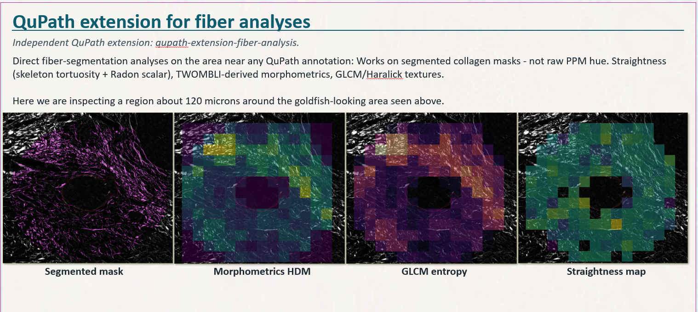
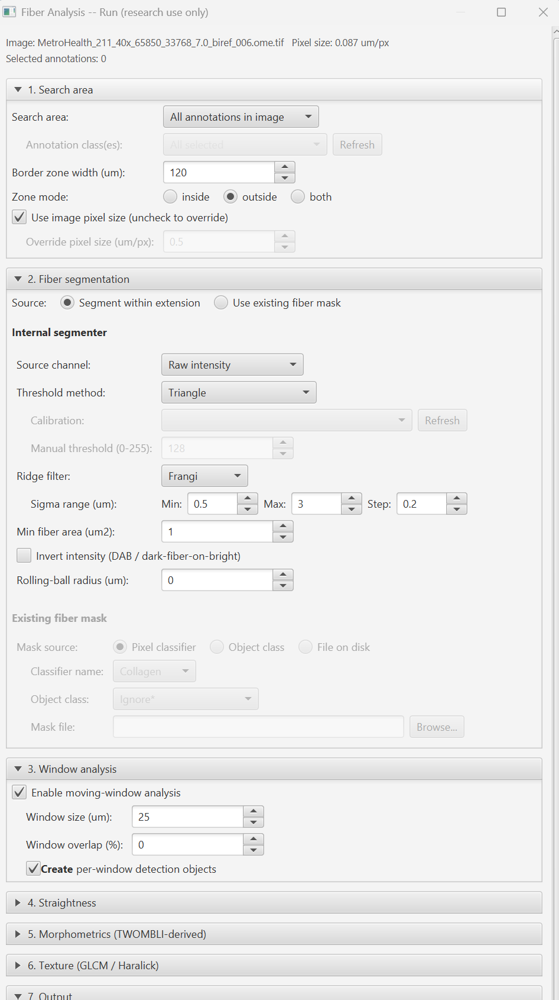

# Fiber Analysis -- User Guide

[Back to README](../README.md)

---

This guide expands on the README's "What the analyses tell you"
section. Each numbered section is collapsible -- click the summary
line to expand. The math notes (sections 5-8) are the source of truth
for what the Python module computes; the README parameter table is
the source of truth for the dialog.

Framing note (per the Phase 0 Lead correction): this extension
analyses **segmented collagen fibers**, not raw birefringence hue.
Orientation, where it appears at all, is the geometric tangent of the
fiber skeleton. There is no hue-to-angle calibration.

---

<details>
<summary><strong>1. Overview</strong></summary>

This extension is a research **testbed** for quantifying collagen
fiber organisation around a user-drawn annotation. It takes a
segmented fiber mask (either produced internally from intensity
thresholding plus optional ridge filtering, or supplied by the user
from a pixel classifier / object class / file) over a **dilated
border zone** around the annotation, and reports three families of
metrics: **straightness / persistence**, **morphometrics** (the
cheap, segmentation-only subset of TWOMBLI), and **GLCM / Haralick
texture**. The headline use case is the wavy-to-straight axis of
collagen organisation -- the same axis underlying TACS-3 in breast
pathology (Conklin et al. 2011) and, more broadly, fiber
reorganisation in tumour invasion, arterial adventitia, sclera,
alveolar wall, and cardiac fibrosis. The PS-TACS workflow shipped by
the production `qupath-extension-ppm` is a related but distinct
analysis (Qian et al. 2025): PS-TACS scores **perpendicularity** of
fibers relative to the boundary using a hue-calibrated orientation
field, whereas this extension scores **shape and texture of the
segmented fibers themselves**, with no hue calibration.

The four outputs from one analysed region -- here a border zone about
120 microns wide -- are the segmented fiber mask, a morphometrics HDM
map, a GLCM entropy map, and a straightness map:



Read the document in order if you are setting up the workflow for
the first time. Section 2 explains how an annotation becomes
per-window metrics; sections 3 and 4 cover the two inputs the user
controls most (search-area dilation and segmentation source); section
5 explains the moving-window grid that the rest of the pipeline
builds on; sections 6-8 are the metric families; section 9 lists
output files; section 10 catches common failures; section 11
collects citations.

</details>

<details>
<summary><strong>2. Workflow</strong></summary>

The pipeline is a linear chain:

```
QuPath annotation
        |
        v
dilated-border zone (mask)        <-- Section 3
        |
        v
fiber segmentation                <-- Section 4
  (internal: threshold + optional ridge filter)
  (existing: pixel classifier / object class / file)
        |
        v
moving-window grid over the zone  <-- Section 5
        |
        v
+-----------------+-----------------+-----------------+
|                 |                 |                 |
v                 v                 v                 v
per-window      per-window       per-ROI         per-window
tortuosity      morphometrics    Radon scalar    GLCM features
(Section 6)     (Section 7)      (Section 6)     (Section 8)
        |
        v
overlays (PNG) + windows.json + optional PathObjects
```

The Run dialog drives this chain. Section 1 sets the search area
(border zone width and zone mode), Section 2 picks the segmentation
source, and Section 3 configures the moving-window grid; the
Straightness, Morphometrics, Texture, and Output sections follow
below:



The Java side reads the annotation geometry, rasterises the dilated
border zone, and dispatches an Appose task with the parameter dict.
The Python module (`fiberlib/`) is bundled inside the JAR; it loads
from JAR resources at run time so the analysis code is always in
sync with the JAR you installed. The Appose env (Pixi-managed) lives
at `~/.local/share/appose/qupath-fiber-analysis/` and is built on
first use.

## Reproducing a run from disk

Every analysis that writes files (per-annotation Run, Project density map,
Project calibration) also drops three companion artifacts next to its
outputs:

- `params.json` -- pretty-printed JSON: extension version, timestamp,
  run id, and every dialog control.
- `params.txt` -- same key/value pairs as plain `key = value` lines; easy
  to skim or grep.
- `rerun.groovy` -- a Groovy script that re-executes the same analysis
  headlessly. Project path, image name, and `params.json` path are baked
  into the top of the file as string literals; edit them if the project
  moves.

To re-run from disk with no GUI:

```
~/path/to/QuPath script <output-dir>/rerun.groovy
```

The Groovy templates use the existing extension entry points (the same
`runForAnnotations` / `runForEntries` / `FiberCalibrationRunner.run` the
GUI dialogs call). Output goes to the same on-disk location as the
original GUI-driven run -- a re-run replaces the previous run's files in
place.

## Project density map (whole-slide)

For density-of-fiber maps across an entire slide, use the separate
**Project density map** workflow rather than the per-annotation Run
dialog. It tile-streams each selected image, runs the same per-window
computations, and writes one small map file per image at
`<project>/fiber-analysis/density-maps/<image>_density.ome.tif`.

**The map file holds one value per window, not per image pixel.** A 25 µm
window moved 6.25 µm at a time on a 16952 x 18225 slide at 0.1732 µm/px is a
467 x 503 grid, a few megabytes. That grid is all the information the map has:
each value averages one window, and drawing it at full image resolution only
repeats or interpolates those values. (Until 2026-10-19 the file was written at
full image resolution, 9 GB for that slide with **Smooth** on. Maps from before
then cannot be read; re-run them.)

The file is a float32 OME-TIFF, so values are physical (`Fiber coverage (%)`
reads 0-100, `Order parameter` 0-1); NaN means no data. Its description says
where the grid sits on the image:

```
Placement: source_width=16952; source_height=18225; source_pixel_um=0.1732; cell_px=36; window_px=144; x0=54; y0=54; grid=467x503; render=bilinear
Source image: <the image the map was computed on>
```

Grid pixel (i, j) covers image pixels `x0 + i*cell_px` to `x0 + (i+1)*cell_px`
across (and the same with `y0` down): the block centred on the window that
produced it, so the map sits over the tissue it describes. `render` says how to
draw between cells (below, **Smooth**). The `Mean angle (deg)` channel row ends
in `; axial=180`: it is averaged and interpolated as an angle of period 180. Image pixels outside the grid have no
value: in per-window mode, a strip half a window wide around the windows and,
at the right and bottom, up to one more stride. Channel names match the QuPath
measurement-table column names: `Fiber coverage (%)`, `HDM`, `Ridge count`,
`Skeleton length (um)`, `Branch points`, `Mean angle (deg)`, `Order parameter`,
`Signal density (no threshold)`, `Intensity coherence (no threshold)`.

Three ways to use a map:

- **Show it as an overlay** (next section). The image is not changed.
- **Sample it into measurements**: `Sample fiber density into measurements`
  adds a `Density: <channel>` measurement per channel to each selected object
  (or every annotation): the mean of the map inside the object, read every
  quarter cell (the mean angle as an axial mean). An object smaller than that
  takes the value at its centre.
- **Add it as channels in a new image**: `Add density channels as a new image`,
  or the first output option in the dialog for every image in the run. This
  adds a new project entry named `<image> [fiber density]`: the image, converted
  to 32-bit float, followed by the map's channels at the image's size, for
  QuPath's `Add intensity features`, thresholders or classifiers. The original
  entry is not changed. The new entry copies the original's metadata (and its
  objects as last saved) and adds three keys, `Fiber analysis` (`Density
  channels` or `Classifier channels`), `Fiber source image` and `Fiber map`, so
  it can be sorted or filtered in the project list and the metadata browser.
  On an RGB image the first three channels are shown red, green and blue over
  0-255, so it looks like the original; the map channels start hidden. Adding
  the same map again refreshes that entry instead of making another, and
  re-running the map refreshes it too. The entry reads the map file when it
  opens, so it needs this extension installed and the map file kept.

  Before 2026-10-19 this attached the channels to the open image instead, and
  values were stored in the image's own pixel type: on an 8-bit or 16-bit image
  every map value was cut to a whole number (a signal density of 0.12 read 0).
  Measurements taken that way are wrong.

### Showing a map as an overlay

`Extensions > Fiber Analysis > Show density map as overlay...` draws one channel
of a density map (or of a window-classifier probability map) over the open
image in colour, without changing the image. Pick the map, the channel, one of
QuPath's colour maps and a value range (**Auto** uses the 1st to 99th
percentile). The list holds the open image's own maps first, then maps made on
any other project image of the same size, marked `(from <image>)`: other images
of the same slide, such as a map computed on the birefringence image shown over
the brightfield one. No-data areas are transparent. The overlay is coloured from
the grid at screen resolution each time the view changes, so it is exact at any
zoom, and the viewer's location bar shows the map value under the cursor.
**Hide values at or below the minimum** leaves the lowest values undrawn instead
of painting them in the first colour, so the image shows through where there is
nothing to see, such as the slide background around the tissue. Set the minimum
to the background level first.

**Mean angle (deg)** is an orientation, where 1 and 179 degrees are two degrees
apart. A linear colour map paints those two at opposite ends of the scale, so
choosing that channel switches to the cyclic map **Angle (cyclic)**, whose last
colour is its first, and fixes the range to 0-180 so a colour means the same
angle on every image (**Auto** keeps 0-180 for this channel). **Angle (cyclic
vivid)** is the saturated hue wheel: easier to read, but yellow looks brighter
than blue, so use it to show results rather than judge them. Both maps come from
TME Quant and keep its names, so with both extensions installed each appears
once. **Brightness from** darkens the colour where a 0-1 channel is low; for the
angle it defaults to **Order parameter**, so well-aligned fibers show strong
colour and randomly oriented ones fade to black instead of getting a confident
hue. (Order parameter needs fibers; **Intensity coherence** works without a
threshold.) Where the map is drawn smooth, the angle is interpolated as an
angle, so 170 and 10 degrees blend through 0, not 90; the same holds for
sampling and the channels entry. It
sits on QuPath's pixel-classification layer, so the opacity slider and **Show
pixel classification** (`C`) control it, and showing it replaces a pixel
classifier overlay. An RGB image keeps its normal look.

A window-classifier map's **Predicted class index** channel is drawn in the
colour each class already has in QuPath, not on a colour map, so the colour map,
range and hide controls are switched off for it. The class names come from the
map's `P(<class>)` channels. A window the model abstained on is not drawn, and
the location bar names the class under the cursor. For a classifier map,
**Brightness from** also offers **Max probability**, which fades the windows the
model was least sure of.

### Per-window or per-pixel

- **Per-window** gives one value per window of the grid, so the map shows
  cells the size of the window stride.
- **Per-pixel** centres a window of the same size on each sample point, so
  values are comparable with per-window mode; only their spacing differs.
  The **Output step (um)** sets that spacing. At 0 (automatic) it is one
  eighth of the window, made coarser if the map would not fit in half of
  QuPath's memory; the step it used is written to the log. A smaller step
  gives a smoother map and costs memory, not computation: the work is one
  pass of box filters over each tile whatever the step. `Ridge count` is not
  available per pixel. Near the slide edge, a window that hangs off the image
  is averaged over the part inside it.
- **Smooth** is recorded in the map rather than baked into it: the overlay,
  the channels entry and sampling interpolate between cell centres when it is
  on and fill each cell when it is off. The file is the same size either way.

### Collagen presence without a threshold

Every other channel is measured on the segmented fiber mask, so it carries
whatever the threshold got wrong. On synthetic test images the mask
over-reads collagen coverage by 20-30 percentage points. Two channels never
see the threshold:

- **Signal density (no threshold)** is the mean intensity in the window, as a
  fraction of the channel's full scale (0-1 of 255 for 8-bit, of 65535 for
  16-bit). It uses the same intensity the segmentation thresholds: the
  chosen channel, **Invert intensity** if set, and **Rolling-ball radius** if
  set. It is never rescaled to each image's own brightest value, so two slides
  imaged with the same settings can be compared directly. Without a rolling
  ball it includes the background level. Use it to find where collagen signal
  is, independent of where a threshold puts the fiber edges.
- **Intensity coherence (no threshold)** measures how aligned the texture is,
  from 0 (no preferred direction) to 1 (perfectly parallel). It is the
  coherency `(l1 - l2) / (l1 + l2)` of the image's structure tensor summed
  over the window (Bigun and Granlund 1987; used for collagen by Rezakhaniha
  et al. 2011). It describes the whole window, background included, and is
  NaN only where the image is perfectly flat. In a dark, noisy window it can
  pick up faint structure in the noise, so read it together with signal
  density.

These channels were prompted by the local density and coherence maps of
PyTextureAnalysis (Kulkarni 2023), whose density follows Qian et al. (2022).
No code was taken from it.

### One threshold for the whole run

With **Otsu** or **Triangle** selected, the density map does not let each tile
pick its own threshold: a nearly empty tile would cut into background noise
while its neighbour clipped faint fibers, so coverage would jump at tile edges
and could not be compared between slides. Instead it samples a 4 x 4 grid of
tiles (up to 1024 px each) spread over every selected image, runs the chosen
method once on the pooled histogram (4096 bins on the channel's full scale),
and every tile of every image uses that value. With one image selected that is
a slide-level threshold; with several it is shared across them. The value and
how it was obtained are written to `_density_params.json`
(`projectThresholdNorm`, `thresholdSource`), and the re-run script replays that
value rather than sampling again. **Manual** and **Project Otsu** are already
one value.

The window classifier does the same at training time, pooled over the training
images, and stores the whole segmentation (threshold included) in the model.
Applying the model segments new slides with those stored settings, not with
whatever the preferences say at the time; the Apply dialog shows which.

### Tiling

Whole slides are computed in tiles. Each tile is read with a margin of
surrounding image, so that filters near the tile edge (smoothing, rolling
ball, ridge filters, the windows themselves) see real tissue rather than the
edge of the tile. Only the tile's own windows are kept. Within that margin the
threshold-free channels, coverage and orientation are exactly what a single
whole-image run would give. Skeleton-based counts (ridge count, branch points,
skeleton length) are not local, because a fiber can run any distance, so they
can still differ slightly at tile seams.

The optional object-density and pixel-positivity channels are computed on the
same tiles and the same windows as the fiber channels. Each tile rasterises
only the annotations and detections that reach it, or reads and thresholds
only its own pixels, so memory stays at one tile whatever the slide size.

See the project README's "Project density map (WSI scale)" section
for the full menu / validation matrix / limitations.

### Calling fiberlib as a library (outside QuPath)

The entire pipeline is also a plain Python function -- the Appose task
script (`scripts/run_fiber_analysis.py`) is only a thin wrapper that
unpacks the injected globals, loads the PNGs, and calls it. To run the
exact same analysis from host Python (tests, batch jobs, the
collagen-phantom tooling):

```python
import fiberlib                      # pip install -e . , or add the
                                     # fiberanalysis resource dir to sys.path
out = fiberlib.analyze(
    image,                           # numpy (H, W) or (H, W, 3)
    pixel_size_um=0.5,
    zone_mode="inside",              # whole-field analysis: 'inside' + a
    border_zone_width_um=800,        # border wider than the region
    window_enabled=True, window_size_um=80,
)
metrics = out["result"]              # JSON-friendly summary dict
windows = out["window_grid"]         # per-window arrays (or None)
```

`analyze()` takes the same parameter names the Appose side injects (see
its docstring), returns `result` / `window_grid` / `fiber_mask` /
`analysis_mask` / `skeleton`, and only writes sidecar files when
`output_dir=` is given. A repo-root `pyproject.toml` exposes `fiberlib`
via `pip install -e .`. Note the analysis runs inside the dilated zone
around the boundary mask, so for a whole-image baseline pass a full
boundary with `zone_mode="inside"` and a large `border_zone_width_um`.

Outputs land in the per-annotation subfolder under the output
directory and are also surfaced as buttons on the results panel
card. At most one overlay is shown on the image at a time -- clicking
a different `[Show ...]` button replaces the current overlay;
`[Hide overlay]` clears it.

</details>

<details>
<summary><strong>3. Search area (dilated border zone)</strong></summary>

The search area is a band of pixels within a configurable distance
of the annotation boundary. Three controls govern it (Section 1 of
the dialog):

- **Border zone width (um)** -- the distance from the boundary
  contour, in image units. Default 50 um; the same default as PPM's
  perpendicularity workflow, so the two extensions can be compared
  apples-to-apples.
- **Zone mode** -- what to measure. `whole annotation` uses the entire
  interior; the other three are a band of the border-zone width taken at
  the boundary.
  - `whole annotation` -- everything inside the annotation. Border zone
    width is ignored. Use this when the annotation already marks the
    tissue you want measured, which is the case for a pathologist-marked
    region or an acquired-area mask.
  - `outside` -- the band on the stromal side only. The right choice when
    the annotation encloses a tumour and the question is about the
    peritumoural stroma.
  - `inside` -- the band just inside the annotation boundary.
  - `both` -- a symmetric band straddling the boundary.

  Picking a band mode when you meant the whole annotation is quiet rather
  than loud: the run completes and the coverage numbers are simply measured
  somewhere else. On annotations that marked an acquired area, `outside`
  reported 0.56% fiber coverage for a region that was 43.3% fiber, because
  the band fell outside the acquired data. If a coverage figure looks
  impossibly low, check this control first.
- **Fill holes** is performed automatically before computing the
  distance transform, mirroring the PPM convention. Small interior
  holes in the annotation would otherwise create stray inner
  boundaries.

Implementation: the zone mask is built by `compute_border_zone_mask`,
lifted verbatim (with attribution comment) from `ppm_library`'s
`surface_analysis.py` -- MIT-licensed, identical semantics to PPM's
search-area pattern. The implementation is `binary_fill_holes` ->
`distance_transform_edt` of the boundary -> threshold at the
dilation distance, with the zone-mode mask applied at the end.

Practical guidance: if you see metric values change significantly
when you increase the band width past ~100 um, the analysis is
picking up structure beyond the immediate boundary -- which may or
may not be desired. Smaller bands (~25 um) tighten the boundary
focus but increase per-window noise (fewer fibers per window).

</details>

<details>
<summary><strong>4. Fiber segmentation</strong></summary>

The extension supports two segmentation modes selected by the
top-of-section radio button. The choice is binary at runtime; the
disabled mode's controls stay visible but greyed.

**Mode A: Segment within extension (Internal).** The image is
projected onto a scalar **source channel** -- Raw intensity by default,
or Raw intensity / Hue / Saturation / Value derived from RGB, or any
of the image's own channels listed by name -- then
thresholded with **Otsu**, **Triangle**, or **Manual** at a chosen
gray level. The manual cutoff is in the source image's **own gray
levels**, so on a single-channel 16-bit image the spinner runs
0-65535 and typing 4500 cuts at 4500 -- in every region and every
image, not rescaled to each region's brightest and darkest pixel.
Optionally a **ridge filter** (Frangi, Sato, or
Meijering from scikit-image) runs first across a configurable
**sigma range** (default 1-4 um, step 1 um) to enhance line-like
structures before the threshold. The thresholded mask is then
cleaned: `binary_closing` to bridge 1-px gaps, then
`remove_small_objects` at the **Min fiber area** (default 1.0 um2).
The clean mask is the fiber segmentation.

### Large annotations are tiled automatically

A region larger than 64 megapixels at the read scale is split into
tiles and analysed a tile at a time, so tissue size is not a limit.
Two limits made this necessary: Java cannot allocate a raster above
`Integer.MAX_VALUE` samples, and PIL warns above roughly 89 MP. A
15.5 x 12.5 mm SHG sample at 0.1732 um/px is 7.16 gigapixels, which is
3.3x past the Java cap on its own.

Tiles are placed on the window lattice and overlap by one window, so
every window position an untiled run would produce is produced exactly
once, at identical coordinates. The merged `windows.json` is therefore
the one an untiled run would have written.

Two consequences worth knowing:

- **Per-fibre metrics are approximated.** A fibre crossing a tile seam
  is truncated in both tiles, so tortuosity and fibre counts are
  aggregated across tiles rather than measured end to end. Per-window
  metrics (coverage, orientation, order parameter, GLCM) are exact.
- **No annotation-level overlays for a tiled run.** At this size a
  single full-resolution PNG cannot be allocated either. Per-tile
  overlays are kept under `tiles/`.

`Analysis downsample` remains the lever for trading detail against
time. Note it runs out quickly for SHG: at 0.1732 um/px a 1 um fibre
spans about 6 px, so a downsample of 2 already leaves under 3 px
across the thinnest fibres.

Two limits worth knowing before choosing Manual:

- A **ridge filter changes what the number means.** A vesselness
  response carries no image units, so with Frangi / Sato / Meijering
  selected the manual value is read as that same fraction of full
  scale (4500 of 65535 = 6.9%) of the response's own range. Otsu and
  Triangle are unaffected either way.
- On a multi-channel image, **name a channel to keep 16-bit
  precision.** Regions are handed to Python as PNG, and PIL has no
  16-bit colour mode, so a multi-band 16-bit region would be truncated
  on load (raw 4500 arriving as 17). Selecting one of the image's own
  channels in **Source channel** sends that single band instead, which
  survives intact -- and the manual spinner then opens up to 0-65535.
  The four derived choices (Raw intensity / Hue / Saturation / Value)
  need all three colour bands, so they cap the spinner at 255.

Practical guidance for mode A:

- **Brightfield Picrosirius Red.** Value channel + Otsu + ridge
  filter `None` is the usual starting point. The collagen signal is
  high-Value, so Value-Otsu separates it well. Add a Frangi sweep
  (sigma 1-3 px) if fibers are dim and partially merged.
- **Polarised-light / PPM birefringence.** Saturation channel +
  Otsu often works because birefringent collagen produces high
  saturation. Threshold rarely needs ridge filtering here.
- **Picrosirius Red on H&E counter-stain (PSR+H&E).** Hue-channel
  thresholding is delicate -- use a pixel classifier instead (Mode
  B). Try this only if the H&E nuclei are very pale.
- **Fluorescence collagen labels (e.g. SHG).** Raw intensity + Otsu.

**Mode B: Use existing fiber mask.** Three sub-sources:

- **Pixel classifier** -- pick a classifier trained in the current
  project. The classifier output is rasterised to a binary fiber
  mask on the dilated-zone region.
- **Object class** -- pick a PathClass; the Java side rasterises all
  objects of that class into a binary mask before dispatching the
  Appose task.
- **File on disk** -- a `.tif` or `.npy` file with a binary mask
  matching the analysed image dimensions.

Practical guidance for mode B: if you have already trained a pixel
classifier on this image type, **prefer Mode B** -- the classifier
sees more context than a per-channel threshold and is more robust
to staining variation. Mode B also lets you reuse a curated
segmentation across many annotations.

**Honest limit on metric quality.** Segmentation quality bounds
metric quality. A mask with broken fibers gives an inflated branch-
point count and a depressed straightness (skeleton paths between
the breaks are shorter and straighter individually, but there are
more of them). Check the `fiber_mask_overlay.png` against the raw
image before interpreting straightness or morphometrics. Texture is
slightly less segmentation-sensitive because GLCM operates on the
quantised scalar image rather than the binary mask -- but
segmentation still gates which windows have enough fibers to score.

</details>

<details>
<summary><strong>5. Window analysis</strong></summary>

Once the dilated zone is segmented, a **moving-window grid** is laid
over it. Square windows of side `W_um` (default 15 um, matching
PPM's Phase-2 default) tile the zone, with stride `W_um * (1 - p)`
where `p` is the overlap fraction (default 0). Larger windows
(~30-50 um) are recommended when Radon straightness is the headline
metric; smaller windows resolve finer spatial variation but increase
per-window noise.

The grid implementation is lifted from PPM's `compute_window_alignment`
(MIT, attribution comment retained). It computes the per-window mean
fiber-pixel count plus the **axial circular statistics** described in
the math note below. The same window list is then re-used by the
straightness, morphometrics, and texture families so that all
per-window records line up in `windows.json`.

**Math note -- axial circular statistics.** Fiber tangent angles
are axial (`theta` and `theta + 180` indistinguishable), so the
doubling trick applies. Per window of N fiber pixels:

```
mean_2theta = arctan2( sum(sin 2 theta_i) , sum(cos 2 theta_i) )
mean_theta  = mean_2theta / 2 mod 180
OS          = sqrt( mean(cos 2 theta_i)^2 + mean(sin 2 theta_i)^2 )
```

`OS` is in `[0, 1]` (0 = isotropic, 1 = perfect axial alignment),
equivalent to vector coherence after angle doubling, and the same
OS reported by PPM's Phase-2 windowed analysis -- so the two
extensions can be compared directly.

A window is considered **non-empty** if its fiber-pixel count
exceeds a small floor (the same `min_pixels` floor PPM uses);
metrics for empty windows are written as `NaN` in `windows.json` and
shown as transparent in the heatmaps.

</details>

<details>
<summary><strong>6. Straightness</strong></summary>

Two complementary straightness measurements: **per-window skeleton
tortuosity** for the heatmap, and a **per-ROI Radon scalar** for the
overall rigidity score on the annotation.

**Math note -- skeleton tortuosity.**
`skimage.morphology.skeletonize` once per ROI (medial axis, O(N^2)).
Walk paths between branch / end-points; per path:

```
straightness = chord_length / arc_length     in [0, 1], 1 = straight
```

CT-FIRE convention (Bredfeldt et al. 2014), same direction as `OS`.
Aggregate per window with median (robust to short spurs) plus
N-fibers for weighting. Apply `binary_closing` and a minimum-branch-
length prune (`min_branch_um`, default 5 um) to suppress noise spurs
that depress the ratio.

**Note the direction, and the name.** This ratio is chord/arc: 1.0 for
a straight fiber, falling as it waves. That is what CT-FIRE calls
*straightness*; tortuosity is its reciprocal. The output key
`mean_tortuosity` therefore carries a straightness value. It keeps the
name because it is already in shipped `results.json` files and QuPath
measurement tables.

**Fibers are traced through crossings.** A skeleton of overlapping
collagen is a network. On the waviness phantoms, 540 drawn fibers
produce around 22 real junctions each, so cutting the skeleton at every
junction measures the pieces between crossings rather than fibers: the
median piece at the waviest setting was 28 px against a drawn length of
160. `trace_fibers` instead follows the continuation whose direction
best matches the one arriving, refusing joins sharper than 70 deg. That
roughly doubles the median traced length and widens the response to
waviness by a third. `median_fiber_len_px` is reported alongside the
straightness statistics precisely so you can see which of the two you
are looking at.

Junctions are found with the Rutovitz crossing number, not a neighbour
count. A rasterised diagonal runs as a staircase, and a staircase corner
has three neighbours while being topologically ordinary -- 65% to 97% of
the "branch points" a neighbour count reports on these phantoms are
corners. `morphometrics.branch_points` was inflated by 2x to 30x before
this was fixed. Endpoints keep the neighbour-count test, which is right
for them and which the crossing number is not.

The **per-window** branch count was fixed one release later, in v0.3.5.
Until then the per-annotation scalar used the crossing number while the
per-window array still counted neighbours, so the same skeleton gave two
different answers: 2,493 branches per-annotation against 7,296
per-window on the wav-25 phantom. Both now use the same rule, and a test
asserts the per-window counts sum to the per-annotation total over a
tiled region. **If you have `Branch points` measurements from a run made
before v0.3.5, they are inflated and should be recomputed.**

Summary statistics beside the mean: `mean_straightness_len`
(length-weighted, so a 3-px stub does not count as much as a 300-px
fiber), `straightness_p10` (the waviest decile -- the most responsive of
the set), `straightness_median`, `straightness_sd`, and `wavy_fraction`
(below 0.85; easy to read but it saturates). Measured against the
phantoms, all of these rank both the waviness and the jaggedness series
at Spearman |rho| = 1.000.

**Math note -- per-ROI Radon.** scikit-image
`radon(biref_intensity * fiber_mask, theta=arange(0, 180), circle=True)`
over the largest disk inscribed in the region. Chord-normalise (divide
each row by the chord length `2*sqrt(R^2 - rho^2)` through the
aperture) to suppress the spurious 45 deg peak, then keep
`|rho| <= 0.8R`: that divisor goes to zero at the rim, so the
outermost rows amplify noise without bound. Scalars (Schaub & Gilbert
2011; see also Despotovic & Cosic 2022 for additional method support):

```
E(theta) = var_rho R(., theta)        the angular profile
p(theta) = E(theta) / sum_theta E     normalised to a distribution
PMR      = max_theta E / mean_theta E
AI       = sum of the largest 10% of p   (0.1 = isotropic, 1 = aligned)
FWHM(theta*) of E   (narrower = more strongly aligned)
entropy  = -sum p log2 p   (log2(180) = 7.49 at 1 deg steps = isotropic)
theta*   = (90 - argmax_theta E) mod 180, in image-angle convention
           (0 = horizontal), matching `mean_angle_deg`
```

**The profile must be a spread, not a total.** The Radon transform
conserves mass: every column of the sinogram integrates to the same
image total, so `sum_rho R` is constant in theta (measured CV 0.04%
raw, 0.6% after chord normalisation) and carries no orientation
information at all. Orientation lives in how *concentrated* each
projection is. `sum_rho R^2` -- which earlier revisions of this note
specified -- does vary with theta, but only as the variance plus that
same large constant, which compresses AI into 0.103 to 0.119 across a
full alignment sweep. The variance removes the constant. For the same
reason AI is the top-decile mass rather than `(max E - min E) /
(max E + min E)`: the min/max form rests on two order statistics and
inverted on the sweep (Spearman 0.905 against 0.976).

PMR is the headline straightness scalar per dilated-border segment;
entropy detects misalignment to ~+/-2 deg vs FFT's +/-4 deg (Schaub
2011).

**Validation.** Measured against the synthetic phantoms in
`tools/collagen-phantom-creation`, whose generator inputs are the
ground truth. `theta*` and per-window `mean_angle_deg` are exact to
0.2 deg on the known-angle series (0, 30, 45, 60, 90, 135). AI,
entropy, PMR, `fwhm_theta_deg` and `order_parameter` each rank the
alignment sweep at Spearman |rho| >= 0.93 against the generator's
order parameter, over the range 1.0000 down to 0.0203.

**When to use which.** Tortuosity is per-window and per-fiber; it is
the right number to drive the **heatmap** (`straightness_overlay.png`)
because it varies smoothly across the zone and tracks waviness on
the scale of individual fibers. The Radon scalar is per-ROI and per-
**bulk-alignment**; it is the right number for a **single rigidity
score** on the annotation (one number, comparable between
annotations and samples). Han et al. 2025 (npj Breast Cancer) report
useful TACS scoring at 150-180 um ROIs, which is the natural Radon
unit; per-window tortuosity scales below that.

</details>

<details>
<summary><strong>7. Morphometrics (TWOMBLI-derived)</strong></summary>

Native re-implementation of the cheap segmentation-only metrics from
TWOMBLI (Wershof et al. 2021, *Life Sci Alliance* 4(3):e202000880).
This is **not** a port of the TWOMBLI FIJI macro: the macro is
unlicensed, so its source code is not used, and the underlying FIJI
plugins (Ridge Detection, AnaMorf, OrientationJ, BIOP Max Inscribed
Circles) are GPL and not bundled. Native numbers will **not** match
TWOMBLI numerically to 3 decimals -- different implementations of the
same published metric. The TWOMBLI repo
([github.com/wershofe/TWOMBLI](https://github.com/wershofe/TWOMBLI))
is cited for provenance.

All seven metrics derive from the skeleton + mask pair the
straightness pipeline already computes.

**Math notes.**

- **HDM:** `sum(fiber_mask) / area(zone)`.
- **Total fiber length:** skeleton pixel count * pixel size; skeleton
  reused from the straightness pipeline.
- **Branch / end-point counts:** 8-neighbour count per skeleton
  pixel -- `n >= 3` = branch, `n == 1` = end-point.
- **Curvature:** mean tangent rotation per skeleton segment of length
  `L_segment` (default 5 px).
- **Fractal dimension** (box-counting): for `b = 2, 4, 8, 16, ...`,
  count `N(b)` boxes intersecting the skeleton; fit
  `log N(b) = -D_fractal * log b + c`. Expect parameter sensitivity
  (see Caveats in the README); the default box sizes
  `0.25,0.5,1,2,4,8,16` um give a stable D for collagen networks but are
  worth varying if you suspect dimension drift.
- **Lacunarity** (gliding-box): mean / variance of box mass `M(r)`
  over positions; `L(r) = var(M) / mean(M)^2 + 1`. Reported per `r`,
  aggregated by area-under-curve.
- **Gap analysis:** distance transform of `~fiber_mask`; per-gap max
  inscribed circle = local max of the distance transform. Report
  distribution of gap diameters.

**Out-of-v1 scope.** Steger ridge detection (Steger 1998, *IEEE TPAMI*
20(2):113-125) supplies a width-annotated centreline and is the
basis for TWOMBLI's fiber-WIDTH distribution. We do not include it
in v1; the ridge filters in Section 4 (Frangi / Sato / Meijering)
supply a binary mask, not a width-annotated centreline. Fiber-width
distributions are therefore not reported. This may graduate to v2 if
fiber width becomes a hard requirement; see the 2026-05-22
feasibility brief.

</details>

<details>
<summary><strong>8. Texture (GLCM / Haralick)</strong></summary>

Per-window GLCM / Haralick features via
`skimage.feature.graycomatrix` and `skimage.feature.graycoprops`.
Cites Aerts et al. 2014 (radiomics feature set) and Depeursinge et
al. 2014 (3-D texture review -- we use the 2-D math, not 3-D).

**Math note -- GLCM and Haralick features.** Compute on a single
derived scalar channel (biref intensity, or grayscale of the RGB),
not raw RGB.

1. **Quantise** to `L = 16` (or 32) gray levels (uniform binning,
   per-window min-to-max).
2. **GLCM** `P_d_theta(i, j)` = pixel-pair count for gray levels
   `(i, j)` at offset `(d, theta)`. `d in {1, 2, 3}` (`d <=
   window_side / 8`), `theta in {0, 45, 90, 135 deg}`, averaged.
3. **Features** (scikit-image `graycoprops`) on normalised
   `P(i, j)`:

```
contrast      = sum_{i,j} (i-j)^2 P(i,j)
dissimilarity = sum_{i,j} |i-j|   P(i,j)
homogeneity   = sum_{i,j} P(i,j) / (1 + (i-j)^2)
energy        = sum_{i,j} P(i,j)^2
correlation   = sum_{i,j} (i - mu_i)(j - mu_j) P(i,j) / (sigma_i sigma_j)
entropy       = - sum_{i,j} P(i,j) log P(i,j)
```

**Biological reading.** Contrast / dissimilarity rise with abrupt
edges (sharp fiber boundaries, sparse clumps). Homogeneity / energy
rise with uniform fields (dense mats). Correlation rises with
oriented structure (aligned bundles). Entropy rises with disorder --
intratumour-heterogeneity proxy per Aerts 2014. Li et al. 2021
(*BMC Medicine*) report prognostic value for texture-augmented
collagen signatures along the same lines. Reported per window;
per-property heatmaps available -- one per run, via the **GLCM
heatmap property** dropdown in the output section.

**Choosing parameters.** Quantisation `L = 16` is appropriate for
small windows (15-30 um); `L = 32` is appropriate for larger windows
(50+ um) where each window has enough samples to populate the
larger GLCM stably. The default distance set `0.1, 0.2, 0.3` um captures texture at
multiple scales without exceeding the recommended `d <= window_side
/ 8` rule of thumb. The six properties are independent calculations
-- turn off ones you do not need to reduce `windows.json` size; the
runtime cost is dominated by GLCM construction, not property
extraction.

**Out-of-v1 scope.** Multichannel HSV-cube Haralick via mahotas is
v2, not v1. True-3D / volumetric texture features (the focus of
Depeursinge 2014) are out of scope -- our data are 2-D; only the
feature math transfers.

</details>

<details>
<summary><strong>9. Outputs</strong></summary>

Each annotation gets a per-annotation subfolder under the output
directory. Filenames are ASCII; conventions parallel PPM's
per-annotation outputs.

**Files.**

- `windows.json` -- per-window records (centre, size, fiber-pixel
  count, one column per enabled metric). Schema:

```
{
  "x": int,                     # top-left x in image pixels
  "y": int,                     # top-left y in image pixels
  "w": int,                     # window width in pixels
  "h": int,                     # window height in pixels
  "n_fiber_px": int,            # fiber-pixel count inside the window
  "mean_angle_deg": float,      # axial mean fiber orientation, 0-180 (0 = horizontal)
  "order_parameter": float,     # axial OS in [0, 1]; 1 = perfectly aligned
  "tortuosity_median": float,   # per-window median chord/arc (1.0 = straight)
  "n_fibers": int,              # path count contributing to tortuosity
  "glcm_<prop>": float,         # one field per enabled GLCM property
  "hdm": float,                 # local HDM (when enabled)
  ...
}
```

- `fiber_mask_overlay.png` -- segmented fiber mask as a translucent
  RGBA overlay (Greys colormap; transparent outside the dilated
  zone).
- `straightness_overlay.png` -- viridis heatmap of per-window
  tortuosity / Radon scalar (alpha-masked outside the dilated zone).
- `texture_<prop>_overlay.png` -- magma heatmap of the selected
  GLCM property (one per run).
- `morphometrics_overlay.png` -- per-window morphometric heatmap.

**Optional sidecars.**

- `window_metrics.npz` -- raw per-window numpy arrays
  (`mean_angle_deg`, `order_parameter`, `n_pixels`, `centers_px`,
  `tortuosity_median`, `n_fibers`, `glcm_<prop>` per enabled
  property, `hdm`, plus scalar metadata `window_px`, `stride_px`,
  `min_pixels`). For non-JSON consumers (e.g. matplotlib analysis
  scripts).
- `results.json` -- the full result dictionary (per-annotation
  scalars, parameter echo, and a copy of the windows table for
  self-contained reproducibility).
- Per-window **PathObjects** in the QuPath hierarchy -- one
  rectangular `PathDetectionObject` per non-empty window, carrying
  the same measurements as the `windows.json` record. **Off by
  default** because at 15 um windows on a 100 um band, a few
  thousand objects are easy to produce.

</details>

<details>
<summary><strong>10. Troubleshooting</strong></summary>

| Symptom | Likely cause | What to try |
|---|---|---|
| "No fibers found" or empty mask overlay | Threshold method does not match staining; ridge filter sigma range off | Open `fiber_mask_overlay.png` -- if blank, switch source channel or try a different threshold method (Otsu -> Triangle, or Manual at ~30% of the dynamic range). On Picrosirius+H&E, switch to a pixel classifier (Mode B). |
| Blocky heatmap with visible window edges | Window overlap too low; window size too large for the structure | Increase overlap to 50%; reduce window size (15 um -> 7-10 um); but watch for NaN windows. |
| Per-window metric NaN in `windows.json` | Window had fewer fiber pixels than `min_pixels` floor | Either accept the gaps (they appear transparent in the heatmap) or lower the window size so each window has enough fibers. |
| Appose env will not build / build hangs | Stale `pixi.lock`; corrupted env; pixi cache permissions | `Extensions > Fiber Analysis > Setup environment...` to rebuild; or delete `~/.local/share/appose/qupath-fiber-analysis/pixi.lock` and `.pixi/` and rerun. |
| Appose env build fails on Windows | Pixi cache directory not writable; firewall blocking conda-forge | Run `Extensions > Fiber Analysis > Setup environment...` to rebuild; check that the Pixi cache directory (`%LOCALAPPDATA%\rattler\cache`) is writable and that conda-forge is reachable. |
| Windows cp1252 crash on a class name with non-ASCII characters | A user-supplied class name or annotation name contains non-ASCII characters that the logger cannot encode | Logs are ASCII-only by design; rename the offending class or annotation to ASCII (the analysis itself does not care, but the log line that mentions it will crash). |
| Fractal dimension or lacunarity oscillates between runs on similar images | Box-size choices not robust for the fiber scale | Widen the **Fractal box sizes** range (add larger sizes); for lacunarity, ensure the box sizes span the largest gap visible in the image. |
| Straightness near 1.0 across all windows | Skeleton noise spurs are being walked as short, straight paths | Increase **Min branch length** to 8-10 um to prune more aggressively. |

If a non-listed failure mode comes up, save the QuPath log file
(`Help > Show log...`) and the Python script output from the
`results.json` sidecar; both are needed to diagnose Appose issues.

</details>

<details>
<summary><strong>11. References</strong></summary>

Citations for the algorithms and claims in this document. All
appear in the shipped docs (this user guide + the README), not only
in internal artifacts, per the project's
`cite-sources-in-user-facing-docs` policy.

Aerts H J W L, Velazquez E R, Leijenaar R T H, et al. (2014).
  Decoding tumour phenotype by noninvasive imaging using a
  quantitative radiomics approach. *Nature Communications* 5:4006.
  -- Texture feature set framing (section 8, README "What the
  analyses tell you").

Bigun J, Granlund G H (1987). Optimal orientation detection of linear
  symmetry. *Proceedings of the First International Conference on
  Computer Vision* (London), 433-438. -- Structure-tensor coherency
  behind the `Intensity coherence (no threshold)` density channel.

Bredfeldt J S, Liu Y, Pehlke C A, Conklin M W, Szulczewski J M,
  Inman D R, Keely P J, Nowak R D, Mackie T R, Eliceiri K W (2014).
  Computational segmentation of collagen fibers from second-harmonic
  generation images of breast cancer. *Journal of Biomedical Optics*
  19(1):016007. -- CT-FIRE chord/arc straightness convention
  (section 6, README "What the analyses tell you").

Conklin M W, Eickhoff J C, Riching K M, Pehlke C A, Eliceiri K W,
  Provenzano P P, Friedl A, Keely P J (2011). Aligned collagen is a
  prognostic signature for survival in human breast carcinoma.
  *American Journal of Pathology* 178(3):1221-1232. -- TACS-3
  prognostic axis, HR 3.0-3.9 (section 1, section 6, README).

Depeursinge A, Foncubierta-Rodriguez A, Van De Ville D, Muller H
  (2014). Three-dimensional solid texture analysis in biomedical
  imaging: review and opportunities. *Medical Image Analysis*
  18(1):176-196. -- 3-D texture framing; we use the 2-D math only
  (section 8, README).

Despotovic I, Cosic D (2022). Radon transform-based methods for
  fiber alignment analysis. *Frontiers in Physics* 10:915644.
  -- Additional method support for Radon-based fiber alignment
  (section 6).

Han B, Sun K Y, et al. (2025). Computer-assisted TACS scoring of
  collagen organisation in breast cancer at 150-180 um ROIs.
  *npj Breast Cancer*. -- ROI sizing for TACS scoring (section 6).

Han W, Chen S, Yuan W, Fan Q, Tian J, Wang X, Chen L, Zhang X, Wei
  W, Liu R, et al. (2016). Oriented collagen fibers direct tumor
  cell intravasation. *Proceedings of the National Academy of
  Sciences* 113(40):11208-11213. -- Mechanical/biological framing
  for waviness loss (section 1, section 6).

Hapach L A, Carey S P, Schwager S C, Taufalele P V, Wang W, Mosier
  J A, et al. (2022). Phenotypic heterogeneity of breast cancer
  cells motility and migration. *Communications Biology* 5:1051.
  -- Mechanical/biological framing (section 1, section 6).

Kulkarni A (2023). PyTextureAnalysis v1.0. Zenodo.
  [doi:10.5281/zenodo.7562833](https://doi.org/10.5281/zenodo.7562833)
  ([github.com/ajinkya-kulkarni/PyTextureAnalysis](https://github.com/ajinkya-kulkarni/PyTextureAnalysis),
  GPL-3.0; acknowledged for the idea, no code taken). -- Prompted the
  threshold-free signal density and coherence density channels.

Li H, Bera K, Toro P, et al. (2021). Collagen fiber orientation
  disorder from H&E images is prognostic for early stage breast
  cancer: clinical trial validation study. *npj Breast Cancer*
  7:104. (related framing in *BMC Medicine* series) -- Prognostic
  value of texture-augmented collagen signatures (section 8).

Provenzano P P, Inman D R, Eliceiri K W, et al. (2008). Collagen
  density promotes mammary tumor initiation and progression. *BMC
  Medicine* 6:11. -- Foundational framing for collagen-density and
  organisation in tumour biology (section 1, section 6).

Qian S, Wang G, Meng J, Jiang S, Zhou L, Lu J, et al. (2022).
  Identification of human ovarian cancer relying on collagen fiber
  coverage features by quantitative second harmonic generation imaging.
  *Optics Express* 30(14):25718.
  [doi:10.1364/OE.452767](https://doi.org/10.1364/OE.452767) -- Local
  collagen density as a box mean of intensity (the basis of
  PyTextureAnalysis's density map).

Qian X, Guhan R, et al. (2025). Perpendicularity Score for Tumor-
  Associated Collagen Signatures (PS-TACS). *American Journal of
  Pathology* 195(7):1242-1255. -- Boundary-referenced PS-TACS
  method; related but distinct from this extension (section 1
  relationship note only).

Schaub N J, Gilbert R J (2011). Radon transform-based methods for
  characterizing fiber alignment in tissue-engineered scaffolds.
  *Proceedings of SPIE* 7897:78970M. -- Radon entropy detects
  misalignment to ~+/-2 deg vs FFT's +/-4 deg (section 6, README).

Rezakhaniha R, Agianniotis A, Schrauwen J T C, Griffa A, Sage D,
  Bouten C V C, van de Vosse F N, Unser M, Stergiopulos N (2011).
  Experimental investigation of collagen waviness and orientation in
  the arterial adventitia using confocal laser scanning microscopy.
  *Biomechanics and Modeling in Mechanobiology* 11:461-473.
  [doi:10.1007/s10237-011-0325-z](https://doi.org/10.1007/s10237-011-0325-z)
  -- Structure-tensor coherency applied to collagen (OrientationJ).

scikit-image (van der Walt S, Schonberger J L, Nunez-Iglesias J, et
  al.; 2014). scikit-image: image processing in Python. *PeerJ*
  2:e453. Specifically `feature.graycomatrix`, `feature.graycoprops`,
  `morphology.skeletonize`, `transform.radon`, and the Frangi /
  Sato / Meijering ridge filters under `filters`. (sections 6, 7, 8).

Steger C (1998). An unbiased detector of curvilinear structures.
  *IEEE Transactions on Pattern Analysis and Machine Intelligence*
  20(2):113-125. -- Ridge detection (deferred reference for v2
  fiber-width distributions; not implemented in v1; section 7).

Wershof E, Park D, Barry D J, Jenkins R P, Rullan A, Wilkins A, Schlegelmilch K,
  Roxanis I, Anderson K I, Bates P A, Sahai E (2021). A FIJI macro
  for quantifying pattern in extracellular matrix (TWOMBLI).
  *Life Science Alliance* 4(3):e202000880.
  ([github.com/wershofe/TWOMBLI](https://github.com/wershofe/TWOMBLI),
  cited for provenance, not copied). -- TWOMBLI morphometric panel:
  HDM, length, branch/endpoint counts, fractal dimension,
  lacunarity, gap analysis (section 7, README).

</details>
